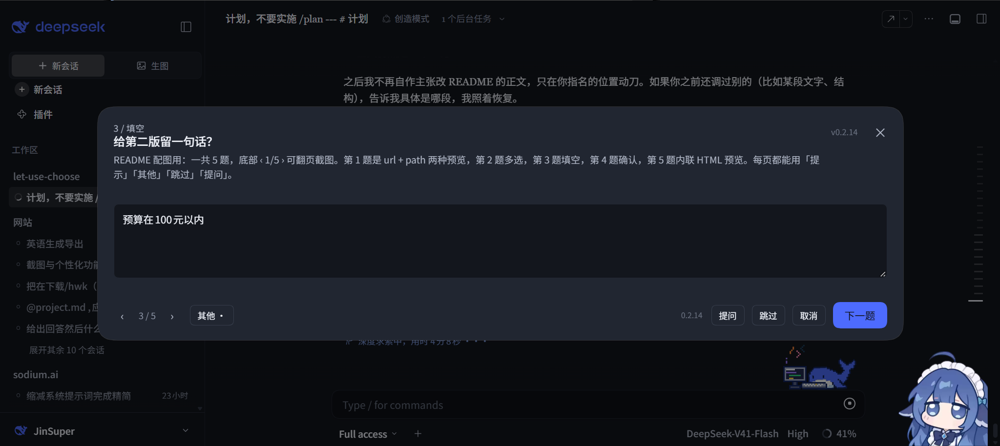
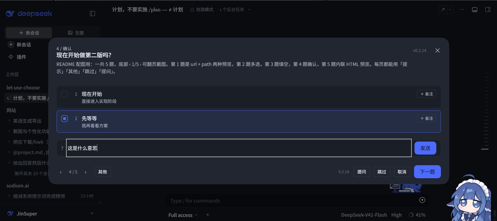
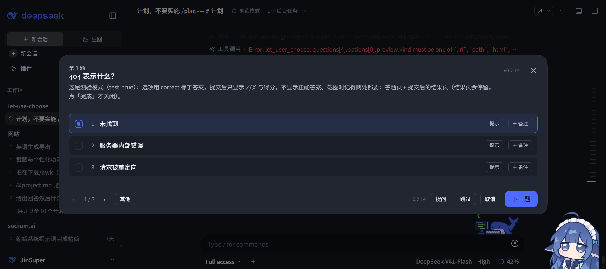
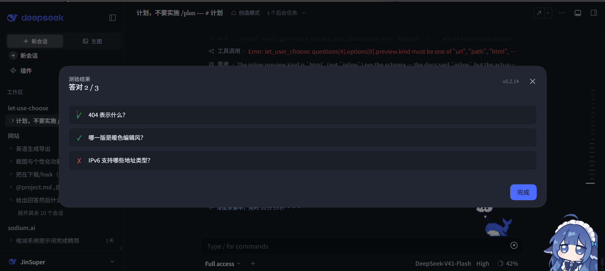
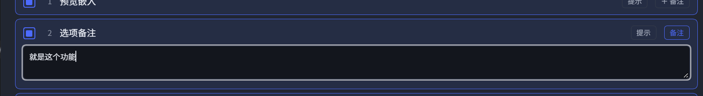

<div align="center">
  
  
  <h1>DSH Visual Option (可视化选项)</h1>
  
  <p><strong>让模型把 ASK-USER-QUESTION 变成看得见的东西</strong></p>
    <p>
    <a href="https://www.npmjs.com/package/dsh-visual-option"></a>
    <a href="https://github.com/JinSuperOfficial/dsh-visual-option/stargazers"></a>
    <a href="https://github.com/JinSuperOfficial/dsh-visual-option/network/members"></a>
    <a href="https://github.com/JinSuperOfficial/dsh-visual-option/blob/main/LICENSE"></a>
    <a href="https://github.com/JinSuperOfficial/dsh-visual-option/issues"></a>
    <a href="https://www.npmjs.com/package/dsh-visual-option"></a>
  </p>
  
  <p>
    一个面向 <a href="https://github.com/deepseek-ai/deepseek-harness">DeepSeek Harness</a>（下称 DSH）Web GUI 的插件<br>
    注册工具 <code>let_user_choose</code>：允许模型传入 HTML 文本 / 网页链接 / 本地路径，向用户提出带预览的选择
  </p>

  <p>
    <a href="#安装">安装</a> ·
    <a href="#快速开始">快速开始</a> ·
    <a href="#工具参数">工具参数</a> ·
    <a href="#配置">配置</a> ·
    <a href="#安全与限制">安全与限制</a>
  </p>

  <p>v0.2.15 · 自检 39/39 · MIT</p>

  <p>
    <a href="./README.md">汉语</a> ·
    <a href="./readme/README-CN-Traditional.md">汉语(漢語)</a> ·
    <a href="./readme/README-EN.md">English</a> ·
    <a href="./readme/README-JP.md">にほんご</a> ·
    <a href="./readme/README-ES.md">Español</a> ·
    <a href="./readme/README-FR.md">Français</a>
  </p>
</div>

---

## 效果对比

<p align="center">
  <video 
    src="https://github.com/user-attachments/assets/2009c5a1-4410-4e32-bde2-fd922cd29fe1" 
    controls 
    width="100%" 
    style="max-width: 800px; border-radius: 8px; box-shadow: 0 4px 12px rgba(0,0,0,0.15);"
  ></video>
</p>

<p align="center">
  <a href="https://www.youtube.com/watch?v=RNSiBdt5ahw"><b>▶ 在 YouTube 观看</b></a> &nbsp;|&nbsp;
  <a href="https://www.bilibili.com/video/BV1e1sG64EUi"><b>▶ 在哔哩哔哩观看</b></a>
</p>


<table>
  <tr>
    <td align="center"><b>visual-option (可视化版本)</b></td>
    <td align="center"><b>ask-user-question (普通版本)</b></td>
  </tr>
  <tr>
    <td align="center"></td>
    <td align="center"></td>
  </tr>
</table>

## 设计灵感

纯文本对话里，模型用 `ask_user_question` 问「A 还是 B」，用户可能还得追问一遍这是什么意思

`let_user_choose` 把候选方案**原样渲染**出来：两个落地页并排 iframe、一份 PHP 模板的源码、一个确认按钮，用户做出选择，可以给任意选项附一句备注，模型拿到的是结构化数据，而不是又一轮对话

整个过程只有三步：
1. 模型调用 `let_user_choose`，把问题和候选方案交给插件
2. 插件在本机起一个临时预览服务，把待选内容推给当前会话的弹窗
3. 用户点选、写备注、提交，模型拿到 `{ status, answers[], summary }`

## 特性

### 五种模式

一个请求可以放多个问题，界面按步骤一次显示一题，底部 `‹ 1 / 2 ›` 是进度，不同模式可以混在同一个请求里，比如第一题多选、第二题填空

#### 1. 单选 (single)
<p align="center">
  
</p>

#### 2. 多选 (multi)
<p align="center">
  
</p>

#### 3. 填空 (fill)
<p align="center">
  
</p>

#### 4. 确认 (confirm)
<p align="center">
  
</p>

#### 5. 测验 (test)
<p align="center">
  <b>题目状态：</b><br>
  
</p>
<p align="center">
  <b>提交答案：</b><br>
  
</p>

### 三种预览

- `url`：任意 http(s) 页面，直接 iframe（外部站点使用更严格的 sandbox）
- `path`：本地页面 / 静态文件，由 Host 起一个一次性预览服务提供，带路径越界保护
- `html` / `php`：内联 HTML / PHP 源码，按需执行 PHP（可配置）

### 选项备注
每个选项都可以单独写备注，备注以 `answers[].notes = [{ label, note }]` 回传

<p align="center">
  
</p>

### 提示
选项可以带 `hint`，界面上是一个小按钮，点开才显示，用户点开过哪些提示会以 `answers[].hints` 回传，模型因此知道哪些题是靠提示做出来的

<p align="center">
  
</p>

### 提问
任意模式、任意一步，用户都可以点「提问」把一句话打回主对话，弹窗随即关闭，工具返回 `status: "asked"` 与问题正文，模型在对话里回答，需要时再重新发起选择

<p align="center">
  
</p>

### 其他与跳过
每个选项题自带一条「其他」输入，用户不想选现成项时可以直接写自己的答案，文字以 `answers[].custom` 回传，每题也可以跳过，答案里是 `skipped: true`，必填题同样放行

<p align="center">
  
</p>

### 原生弹窗
复用 GUI 的主题变量、遮罩、圆角与焦点环，支持 Esc 取消、焦点陷阱、`prefers-reduced-motion`

### 多语言支持
内置 **6 套文案**（简体中文、繁体中文、English、にほんご、Español、Français），支持跟随 GUI 语言自动切换，也可在插件中手动选择

### 宽度自适应
预览宽度可选 `自适应 / 768 / 390`，同一份内容可以按桌面或手机宽度检查

## 安装

需要 DSH `0.2.0-rc` 及以上，Web profile

> [!NOTE]
> 本项目曾用名 `dsh-let-user-choose`，如果你是从旧版本升级，请注意在 `package.json` 中将依赖名和 `dsh.profile.bundles` 里的条目同步修改为 `dsh-visual-option`，工具名和 API 路径保持不变

### Method 1. dsh 插件市场

主界面 -> 插件 -> 添加插件 -> 填入插件链接：
- GitHub Repo: `github:JinSuperOfficial/dsh-visual-option`
- NPM Publish Repo: `dsh-visual-option`

### Method 2. dsh cli

```shell
dsh plugin_manager install_bundle link:/path/to/dsh-visual-option
```
安装后重启；如果装了 hot-reload，等它提示即可

### Method 3. 让 AI 装

```prompt-text
Help me to install this plugin: dsh-visual-option
GitHub Repo: `github:JinSuperOfficial/dsh-visual-option`
NPM: `dsh-visual-option`
Or you could look up the repo: "https://github.com/JinSuperOfficial/dsh-visual-option"
Thanks.
```

### Method 4. 手动安装

等价于两步：
1. 在 profile 的 `package.json` 里加入依赖，并列入 `dsh.profile.bundles`：

   ```json
   {
     "dependencies": { "dsh-visual-option": "link:/path/to/dsh-visual-option" },
     "dsh": { "profile": { "bundles": ["dsh-visual-option"] } }
   }
   ```
2. 插件自带 `cordis.patch.yml`，会在加载时插入 `visual-option` 节点（含默认配置）

## 快速开始

准备两个简单的 HTML 文件，比如放在会话工作目录的 `preview/` 下：

```html
<!-- preview/a.html -->
<!doctype html>
<html>
  <body style="margin:0;background:#f8f2e9;font-family:serif;padding:24px">
    <h1>方案 A</h1>
    <p>暖色编辑风</p>
  </body>
</html>
```

```html
<!-- preview/b.html -->
<!doctype html>
<html>
  <body style="margin:0;background:#0b1020;color:#fff;font-family:sans-serif;padding:24px">
    <h1>方案 B</h1>
    <p>冷色仪表盘风</p>
  </body>
</html>
```

最小的一次单选请求：

```json
{
  "title": "选一个落地页方向",
  "detail": "两个方案都在下面，点选一个",
  "timeoutSeconds": 600,
  "questions": [
    {
      "id": "plan",
      "question": "哪个方向更适合继续打磨",
      "mode": "single",
      "required": true,
      "options": [
        {
          "label": "方案 A · 暖色编辑风",
          "description": "大标题 + 暖橙渐变",
          "preview": { "kind": "path", "value": "preview/a.html" }
        },
        {
          "label": "方案 B · 冷色仪表盘风",
          "description": "数据卡片 + 冷蓝渐变",
          "preview": { "kind": "path", "value": "preview/b.html" }
        }
      ]
    }
  ]
}
```

模型侧拿到的返回值：

```json
{
  "status": "answered",
  "answers": [
    {
      "id": "plan",
      "selected": ["方案 B · 冷色仪表盘风"],
      "notes": [{ "label": "方案 A · 暖色编辑风", "note": "排版更克制，但配色有点重" }]
    }
  ],
  "summary": "plan: 方案 B · 冷色仪表盘风"
}
```

`status` 取值：`answered` / `cancelled` / `timeout` / `asked`，超时返回里会带一句 `hint`，取消与超时都不带 `answers`

## 工具参数

| 字段 | 类型 | 说明 |
| --- | --- | --- |
| `title` | string | 弹窗标题，缺省「请选择 / Choose」 |
| `detail` | string | 标题下方的一段说明 |
| `timeoutSeconds` | integer | `30–3600`，缺省用插件配置的 `timeoutMs`（10 分钟） |
| `questions` | array | 1–8 个问题，见下 |
| `test` | boolean | 测验开关，提交后只给对错与得分 |

**question**

| 字段 | 类型 | 说明 |
| --- | --- | --- |
| `id` | string | 答案回传用，唯一 |
| `question` | string | 问题正文 |
| `header` | string | 小标题（可选） |
| `detail` | string | 补充说明（可选） |
| `mode` | enum | `single` / `multi` / `fill` / `confirm` |
| `required` | boolean | 必填；未填时底部提示、不允许提交 |
| `placeholder` | string | 仅 `fill` 用 |
| `options` | array | 选项；`fill` 必须为空或不传 |

**option**

| 字段 | 类型 | 说明 |
| --- | --- | --- |
| `label` | string | 选项名（备注也以它为键） |
| `description` | string | 选项描述（可选） |
| `preview` | object | `{ kind: "url" \| "path" \| "html" \| "php", value, title? }` |
| `correct` | boolean | 测验模式下标记正确答案 |
| `hint` | string | 可选提示，点「提示」才展开 |

**answers**

| 字段 | 类型 | 说明 |
| --- | --- | --- |
| `id` | string | 对应的问题 id |
| `selected` | string[] | 选中的选项 label |
| `custom` | string | 填空答案，或「其他」里手写的文字 |
| `hints` | string[] | 用户点开过提示的选项 label |
| `skipped` | boolean | 整题跳过 |
| `notes` | array | `[{ label, note }]` 选项备注 |

> [!IMPORTANT]
> 限制：问题 ≤ 8、选项 ≤ 12、`label` ≤ 200 字、备注 ≤ 1000 字、填空 ≤ 4000 字，未知字段会被拒绝；`fill` 的问题不接受选项备注

**关于模式的一点约定**
- `confirm` 只有一个问题时，点选即提交
- 有多个问题时，`confirm` 只是一行两选一，仍需点提交
- 测验模式下每题至少需要一个 `correct: true`，提交后返回 `score: { correct, total }`
- 所有模式的答案都在 `answers[]` 里按 `id` 对应

## 预览细节

| kind | 渲染方式 | 说明 |
| --- | --- | --- |
| `url` | iframe | 仅 `http(s)`；外部域名使用不含 `allow-same-origin` 的 sandbox |
| `path` | iframe | 相对路径按会话 `cwd` 解析，必须落在 root 内；可指向单文件或目录 |
| `html` | iframe | 内联 HTML 源码，直接在弹窗里渲染 |
| `php` | iframe / 源码 | 配置了 `phpBinary` 时执行并渲染输出，否则显示源码 |

**PHP 行为**
- `phpBinary: ""`（默认）——只显示源码，标签为「源码预览（PHP 未执行）」
- `phpBinary: "auto"`——探测 `PATH` 上的 `php`，找到就执行
- 其他值——当作可执行文件路径
- 执行有 8 秒超时、2 MiB 输出上限，错误不回显到页面

**预览服务**
- 每个请求起一个独立的 `http.createServer`，绑定 `127.0.0.1:0`（随机端口）
- 内联文档挂在 `/<token>.html`，静态文件挂在 `/`，token 随机
- 回答 / 取消 / 超时后延迟关闭，端口回收

## 等待与取消

- 弹窗打开后开始倒计时（`剩余 m:ss`）
- 用户第一次移动鼠标、按下、滚轮或键盘输入 → 客户端立即本地隐藏倒计时，并 POST `/api/let-user-choose/hold`；Host 把计时器换成 1 小时安全兜底
- `Esc`、右上角 `×`、底部「取消」都会以 `cancelled` 结束
- 「提问」以 `asked` 结束，把问题交回主对话
- 浏览器标签切到后台时轮询暂停，回到前台立即拉一次
- 超时以 `timeout` 结束

## 配置

写在插件节点（`cordis.patch.yml` 的 insert 或 profile 的 patch 层）：

```yaml
- id: visual-option
  name: dsh-visual-option
  config:
    timeoutMs: 600000     # 默认等待上限（毫秒），夹在 5s–1h
    maxInlineBytes: 65536 # 单个内联 html/php 内容上限
    phpBinary: ""         # "" | "auto" | 可执行文件路径
```

## HTTP 接口（内部）

客户端弹窗与 Host 之间只走 GUI 自带的 `/api` 通道：

| 路径 | 方法 | 作用 |
| --- | --- | --- |
| `/api/let-user-choose/pending?session=` | GET | 当前会话是否有待处理的选择 |
| `/api/let-user-choose/answer` | POST | 提交答案 / 取消 / 提问 |
| `/api/let-user-choose/hold` | POST | 用户已交互，取消限时 |
| `/api/let-user-choose/source` | GET | 源码预览内容 |

## 安全与限制

- 预览服务只监听回环地址：从别的机器打开 GUI 时，本地预览无法加载（弹窗会提示），外部 `url` 预览仍然可用
- 路径预览做 realpath 校验，拒绝 `..`、绝对路径逃逸与符号链接逃逸
- 内联内容有大小上限；超限直接拒绝
- 参考页面不会上传，预览只在你的机器上打开
- 仅在当前正在查看的会话里弹窗；后台会话里的调用会一直等到超时

> [!WARNING]
> PHP 执行默认关闭，开启（如 `phpBinary: "auto"`）即意味着允许模型提供的代码在本机运行，存在远程代码执行（RCE）风险，请自行评估并在受控环境下使用

## 开发

```bash
node selfcheck.mjs # 自检
```

自检覆盖：

```
args    → 选项/备注/超时边界、未知字段拒绝
preview → MIME、404、目录、越界、符号链接、内联 HTML、PHP 源码与执行
hub     → pending / answer / hold / ask / cancel / timeout / abort / dispose
notes   → 往返、空备注丢弃、fill 拒绝备注
other   → 未选选项时用 custom 作答、必填校验、往返
skip    → 跳过必填题、与选项冲突时拒绝
hint    → 选项提示回传、未知 label 拒绝
test    → 参考答案标记、得分回传
```

验收视频的工程在 `demo/`（Electron 离屏渲染 + 真实 `client.js` + 录帧合成）：

```bash
cd demo
npm install
python3 -m http.server 4610 --bind 127.0.0.1 &
~/.dsh/electron/electron app      # 录制到 demo/out/frames/
node encode.mjs                   # 合成 demo/out/acceptance.mp4
```

## 项目结构

```
dsh-visual-option/
├── index.js            # Host 插件：注册工具、/api 路由、配置
├── client.js           # 浏览器弹窗：步骤、预览、备注、提示、提问、测验
├── lib/
│   ├── args.mjs        # 参数校验与归一化
│   ├── preview.mjs     # 预览服务（iframe / 源码 / PHP）
│   └── hub.mjs         # 待处理请求、计时器、hold、答案校验
├── cordis.patch.yml    # 插件自带的挂载声明与默认配置
├── selfcheck.mjs       # 自检
├── test/fixtures/      # 预览夹具
├── demo/               # 验收视频工程
├── logo.svg
├── icon.svg
└── assets/             # README 中的截图存放目录
```

## Roadmap

- [ ] 发布到 npm / dsh 插件市场
- [ ] 图片（`png/jpg`）与 PDF 预览
- [ ] 远程访问时的预览隧道（当前仅限本机）
- [ ] 更细粒度的 PHP 沙箱（超时、禁用函数、只读）
- [ ] 更多语言

## License

MIT © JinSuperOfficial

© 金旭 2026 · JinSuper™
