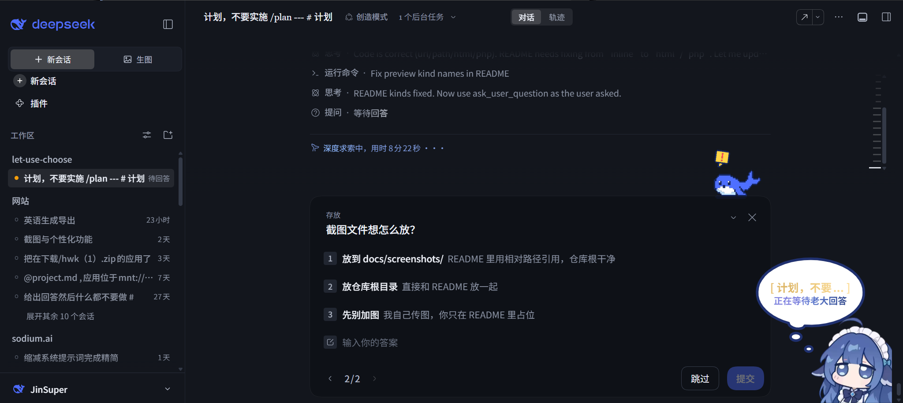
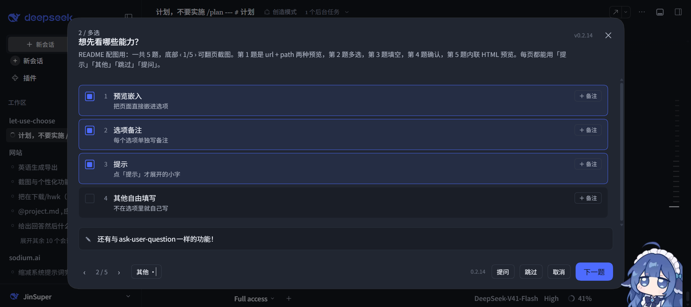
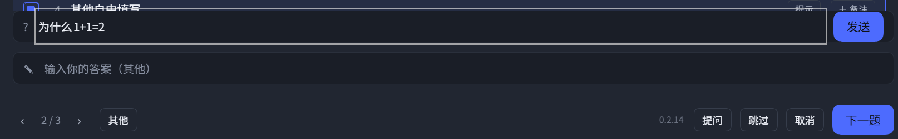

<div align="center">
  

  <h1>DSH Visual Option（視覺化選項）</h1>

  <p><strong>讓模型把 ASK-USER-QUESTION 變成看得見的東西</strong></p>

  <p>
    一個面向 <a href="https://github.com/deepseek-ai/deepseek-harness">DeepSeek Harness</a>（下稱 DSH）Web GUI 的插件<br>
    註冊工具 <code>let_user_choose</code>：允許模型傳入 HTML 文字 / 網頁連結 / 本機路徑，向使用者提出帶預覽的選擇
  </p>

  <p>
    <a href="../README.md">汉语</a> ·
    <a href="./README-CN-Traditional.md">汉语(漢語)</a> ·
    <a href="./README-EN.md">English</a> ·
    <a href="./README-JP.md">にほんご</a> ·
    <a href="./README-ES.md">Español</a> ·
    <a href="./README-FR.md">Français</a>
  </p>
</div>

---

## 效果對比

<table>
  <tr>
    <td align="center"><b>visual-option（視覺化版本）</b></td>
    <td align="center"><b>ask-user-question（普通版本）</b></td>
  </tr>
  <tr>
    <td align="center"></td>
    <td align="center"></td>
  </tr>
</table>

## 設計靈感

純文字對話裡，模型用 `ask_user_question` 問「A 還是 B」，使用者可能還得追問一遍這是什麼意思

`let_user_choose` 把候選方案**原樣渲染**出來：兩個落地頁並排 iframe、一份 PHP 模板的原始碼、一個確認按鈕
使用者做出選擇，可以給任意選項附一句備註，模型拿到的是結構化資料，而不是又一輪對話

整個過程只有三步
1. 模型呼叫 `let_user_choose`，把問題和候選方案交給插件
2. 插件在本機起一個臨時預覽服務，把待選內容推給目前會話的彈窗
3. 使用者點選、寫備註、提交，模型拿到 `{ status, answers[], summary }`

## 特性

### 五種模式

一個請求可以放多個問題，介面按步驟一次顯示一題，底部 `‹ 1 / 2 ›` 是進度
不同模式可以混在同一個請求裡

| 模式 | 說明 |
| --- | --- |
| `single` | 單選，點一行即選中 |
| `multi` | 多選，可以選多個選項 |
| `fill` | 填空，直接輸入一段文字 |
| `confirm` | 確認，兩個選項一行排開，點一下即提交 |
| `test` | 測驗開關（`test: true`），選項用 `correct: true` 標答案，提交後只顯示對錯與得分 |

<p align="center">
  
</p>

### 三種預覽

- `url`：任意 http(s) 頁面，直接 iframe（外部站點使用更嚴格的 sandbox）
- `path`：本機頁面 / 靜態檔案，由 Host 起一個一次性預覽服務提供，帶路徑越界保護
- `inline`：內聯 HTML / PHP 原始碼，按需執行 PHP（可配置）

### 選項備註
每個選項都可以單獨寫備註，備註以 `answers[].notes = [{ label, note }]` 回傳

<p align="center">
  
</p>

### 提示
選項可以帶 `hint`，介面上是一個小按鈕，點開才顯示
使用者點開過哪些提示會以 `answers[].hints` 回傳，模型因此知道哪些題是靠提示做出來的

<p align="center">
  
</p>

### 提問
任意模式、任意一步，使用者都可以點「提問」把一句話打回主對話
彈窗隨即關閉，工具回傳 `status: "asked"` 與問題正文，模型在對話裡回答，需要時再重新發起選擇

<p align="center">
  
</p>

### 其他與跳過
每個選項題自帶一條「其他」輸入，使用者不想選現成項時可以直接寫自己的答案，文字以 `answers[].custom` 回傳
每題也可以跳過，答案裡是 `skipped: true`，必填題同樣放行

<p align="center">
  
</p>

### 原生彈窗
複用 GUI 的主題變數、遮罩、圓角與焦點環，支援 Esc 取消、焦點陷阱、`prefers-reduced-motion`

### 多語言支援
內建 **6 套文案**（简体中文、繁体中文、English、にほんご、Español、Français）
支援跟隨 GUI 語言自動切換，也可在插件中手動選擇

### 寬度自適應
預覽寬度可選 `自適應 / 768 / 390`，同一份內容可以按桌面或手機寬度檢查

### 提示詞引導
插件會往系統提示詞裡加一段引導：要使用者做選擇時預設走 `let_user_choose` 而不是 `ask_user_question`，只有特殊場景才退回原生提問，並且凡是靠文字講不清的（佈局、配色、報錯現場、資料結構、長程式碼差異）必須給對應選項內聯一段 HTML 原始碼預覽，而不是讓使用者自己想像

### 轉錄裡的提問行
對話記錄裡那次呼叫不再是通用工具卡片，而是和原生提問同一排的一行：左邊按模式給圖示，右邊是 `模式：主題`

| 模式 | 圖示 | 文案 |
| --- | --- | --- |
| 單選 | 圓圈裡的問號 | `提問：<標題>` |
| 多選 | 兩個勾選框 + 兩條橫線 | `多選提問：<標題>` |
| 確認 | 方框裡的對勾 | `確認：<標題>` |
| 填空 | 輸入框 + 兩條內線 | `填空：<標題>` |
| 測驗 | 兩張疊放的卡片 | `測驗：<標題>` |

這一行在提問還掛著的時候可以點，等於把彈窗重新展開

### 收起與掛起
彈窗右上角的 `—` 把彈窗收成右下角的小膠囊（圖示 + 模式 + 標題），請求仍然掛起，模型拿不到結果就不會繼續輸出，整顆膠囊都能點開，回到彈窗；膠囊上也有 `取消` 直接結算

> 輸入欄本身不會被接管：DSH 的 `conversation.composer` 是會話級 chain 槽，目前只接受內建 UI 的註冊，第三方插件註冊不進去，所以收起期間仍然可以打字發訊息，只是模型卡在那次工具呼叫上不會繼續說話

### 頂替原生提問（實驗）
`replaceAskUserQuestion: true` 時本插件改用內建名字 `ask_user_question` 註冊工具，這樣所有**按工具名**識別提問的插件（等待氣泡、提示音、側邊欄分類、活動文案等）都會照常觸發

但它有個前提：內建那一行必須先讓位，實測在 `0.2.2-rc.3` 上，`tool-ask-user` 這一行寫在 **agent preset 的 `plugins` 列表裡**，profile 的 patch 按 id 打不到它（會報 `patch: entry "tool-ask-user" not found`），所以常規做法是**自訂一份 preset**，去掉 `tool-ask-user` 後再開啟這個開關；名字被佔時插件會退回 `let_user_choose` 並在日誌裡說明

## 設定頁

設定裡有兩個入口指向同一頁：左側導覽的 **選擇題**，以及 設定 → 插件 → **選擇題** 標籤頁，裡面能當場把每個功能點一遍：

| 區域 | 內容 |
| --- | --- |
| 發起測試 | 單選 / 多選 / 確認 / 填空 / 測驗五個按鈕，在你目前開啟的會話裡真彈一次（沒人等結果，答完即收尾） |
| 服務端參數 | `timeoutMs`、`maxInlineBytes`、`phpBinary`，儲存後即時生效，並落到 `$DSH_HOME/dsh-visual-option.json`，重新啟動後仍然有效 |
| 介面偏好 | 預設預覽寬度（自適應 / 768 / 390）、是否在對話裡顯示模式圖示，存在瀏覽器本地 |

服務端參數只覆蓋 patch 裡同名配置，patch 仍是基線；刪掉那個 json 檔案就回到 patch 的值

## 安裝

需要 DSH `0.2.0-rc` 及以上，Web profile；`0.2.2-rc` 起最佳（那裡 `agents` 服務改用 `get` + `session.header.origin` 判定主會話）

> [!NOTE]
> 本專案曾用名 `dsh-let-user-choose`，如果你從舊版本升級，請在 `package.json` 中把依賴名與 `dsh.profile.bundles` 的條目改成 `dsh-visual-option`
> 工具名和 API 路徑保持不變

### Method 1. dsh 插件市場

主介面 -> 插件 -> 新增插件 -> 填入插件連結
- GitHub Repo: `github:JinSuperOfficial/dsh-visual-option`
- NPM Publish Repo: `dsh-visual-option`

### Method 2. dsh cli

```shell
dsh plugin_manager install_bundle link:/path/to/dsh-visual-option
```
安裝後重啟，如果裝了 hot-reload，等它提示即可

### Method 3. 讓 AI 裝

```prompt-text
Help me to install this plugin: dsh-visual-option
GitHub Repo: `github:JinSuperOfficial/dsh-visual-option`
NPM: `dsh-visual-option`
Or you could look up the repo: "https://github.com/JinSuperOfficial/dsh-visual-option"
Thanks.
```

### Method 4. 手動安裝

等價於兩步
1. 在 profile 的 `package.json` 裡加入依賴，並列入 `dsh.profile.bundles`

   ```json
   {
     "dependencies": { "dsh-visual-option": "link:/path/to/dsh-visual-option" },
     "dsh": { "profile": { "bundles": ["dsh-visual-option"] } }
   }
   ```
2. 插件自帶 `cordis.patch.yml`，會在載入時插入 `visual-option` 節點（含預設配置）

## 快速開始

準備兩個簡單的 HTML 檔案，比如放在會話工作目錄的 `preview/` 下

```html
<!-- preview/a.html -->
<!doctype html>
<html>
  <body style="margin:0;background:#f8f2e9;font-family:serif;padding:24px">
    <h1>方案 A</h1>
    <p>暖色編輯風</p>
  </body>
</html>
```

```html
<!-- preview/b.html -->
<!doctype html>
<html>
  <body style="margin:0;background:#0b1020;color:#fff;font-family:sans-serif;padding:24px">
    <h1>方案 B</h1>
    <p>冷色儀表板風</p>
  </body>
</html>
```

最小的一次單選請求

```json
{
  "title": "選一個落地頁方向",
  "detail": "兩個方案都在下面，點選一個",
  "timeoutSeconds": 600,
  "questions": [
    {
      "id": "plan",
      "question": "哪個方向更適合繼續打磨",
      "mode": "single",
      "required": true,
      "options": [
        {
          "label": "方案 A · 暖色編輯風",
          "description": "大標題 + 暖橙漸變",
          "preview": { "kind": "path", "value": "preview/a.html" }
        },
        {
          "label": "方案 B · 冷色儀表板風",
          "description": "資料卡片 + 冷藍漸變",
          "preview": { "kind": "path", "value": "preview/b.html" }
        }
      ]
    }
  ]
}
```

模型側拿到的回傳值

```json
{
  "status": "answered",
  "answers": [
    {
      "id": "plan",
      "selected": ["方案 B · 冷色儀表板風"],
      "notes": [{ "label": "方案 A · 暖色編輯風", "note": "排版更克制，但配色有點重" }]
    }
  ],
  "summary": "plan: 方案 B · 冷色儀表板風"
}
```

`status` 取值：`answered` / `cancelled` / `timeout` / `asked`
逾時回傳裡會帶一句 `hint`，取消與逾時都不帶 `answers`

## 工具參數

| 欄位 | 類型 | 說明 |
| --- | --- | --- |
| `title` | string | 彈窗標題，缺省「請選擇 / Choose」 |
| `detail` | string | 標題下方的一段說明 |
| `timeoutSeconds` | integer | `30–3600`，缺省用插件配置的 `timeoutMs`（10 分鐘） |
| `questions` | array | 1–8 個問題 |
| `test` | boolean | 測驗開關，提交後只給對錯與得分 |

**question**

| 欄位 | 類型 | 說明 |
| --- | --- | --- |
| `id` | string | 答案回傳用，唯一 |
| `question` | string | 問題正文 |
| `header` | string | 小標題（可選） |
| `detail` | string | 補充說明（可選） |
| `mode` | enum | `single` / `multi` / `fill` / `confirm` |
| `required` | boolean | 必填，未填時底部提示、不允許提交 |
| `placeholder` | string | 僅 `fill` 用 |
| `options` | array | 選項，`fill` 必須為空或不傳 |

**option**

| 欄位 | 類型 | 說明 |
| --- | --- | --- |
| `label` | string | 選項名（備註也以它為鍵） |
| `description` | string | 選項描述（可選） |
| `preview` | object | `{ kind: "url" \| "path" \| "html" \| "php", value, title? }` |
| `correct` | boolean | 測驗模式下標記正確答案 |
| `hint` | string | 可選提示，點「提示」才展開 |

**answers**

| 欄位 | 類型 | 說明 |
| --- | --- | --- |
| `id` | string | 對應的問題 id |
| `selected` | string[] | 選中的選項 label |
| `custom` | string | 填空答案，或「其他」裡手寫的文字 |
| `hints` | string[] | 使用者點開過提示的選項 label |
| `skipped` | boolean | 整題跳過 |
| `notes` | array | `[{ label, note }]` 選項備註 |

限制：問題 ≤ 8、選項 ≤ 12、`label` ≤ 200 字、備註 ≤ 1000 字、填空 ≤ 4000 字
未知欄位會被拒絕，`fill` 的問題不接受選項備註

## 預覽細節

| kind | 渲染方式 | 說明 |
| --- | --- | --- |
| `url` | iframe | 僅 `http(s)`，外部網域使用不含 `allow-same-origin` 的 sandbox |
| `path` | iframe | 相對路徑按會話 `cwd` 解析，必須落在 root 內 |
| `html` | iframe | 內聯 HTML 原始碼，直接渲染 |
| `php` | iframe / 原始碼 | 配置了 `phpBinary` 時執行並渲染輸出，否則顯示原始碼 |

PHP 執行有 8 秒逾時、2 MiB 輸出上限，錯誤不回顯到頁面

## 等待與取消

- 彈窗打開後開始倒計時
- 使用者第一次移動滑鼠、按下、滾輪或鍵盤輸入後，本機立即隱藏倒計時，Host 換成 1 小時安全兜底
- `Esc`、右上角 `×`、底部「取消」都會以 `cancelled` 結束
- 「提問」以 `asked` 結束，把問題交回主對話
- 瀏覽器分頁切到背景時輪詢暫停，回到前景立即拉一次

## 配置

```yaml
- id: visual-option
  name: dsh-visual-option
  config:
    timeoutMs: 600000
    maxInlineBytes: 65536
    phpBinary: ""
```

## HTTP 介面（內部）

| 路徑 | 方法 | 作用 |
| --- | --- | --- |
| `/api/let-user-choose/pending?session=` | GET | 目前會話是否有待處理的選擇 |
| `/api/let-user-choose/answer` | POST | 提交答案 / 取消 / 提問 |
| `/api/let-user-choose/hold` | POST | 使用者已互動，取消限時 |
| `/api/let-user-choose/source` | GET | 原始碼預覽內容 |
| `/api/let-user-choose/settings` | GET / POST | 設定頁讀寫服務端參數，POST 需 `confirm: true` |
| `/api/let-user-choose/selftest` | POST | 設定頁「發起測試」：在該會話造一次真實請求 |

## 安全與限制

- 預覽服務只監聽回環位址，從別的機器打開 GUI 時本機預覽無法載入
- 路徑預覽做 realpath 校驗，拒絕 `..`、絕對路徑逃逸與符號連結逃逸
- 內聯內容有大小上限，超限直接拒絕
- PHP 執行預設關閉，開啟即表示讓模型提供的程式碼在本機執行
- 頁面不會上傳，預覽只在你的機器上打開
- 僅在目前正在查看的會話裡彈窗，背景會話的呼叫會一直等到逾時

## 開發

```bash
node selfcheck.mjs
```

自檢覆蓋

```
args    → 選項/備註/逾時邊界、未知欄位拒絕
preview → MIME、404、目錄、越界、符號連結、內聯 HTML、PHP 原始碼與執行
hub     → pending / answer / hold / ask / cancel / timeout / abort / dispose
notes   → 往返、空備註丟棄、fill 拒絕備註
other   → 未選選項時用 custom 作答、必填校驗
skip    → 跳過必填題、與選項衝突時拒絕
hint    → 選項提示回傳、未知 label 拒絕
test    → 參考答案標記、得分回傳
```

## 專案結構

```
dsh-visual-option/
├── index.js            # Host 插件：註冊工具、/api 路由、配置
├── client.js           # 瀏覽器彈窗：步驟、預覽、備註、提示、提問、測驗
├── lib/
│   ├── args.mjs        # 參數校驗與歸一化
│   ├── preview.mjs     # 預覽服務（iframe / 原始碼 / PHP）
│   └── hub.mjs         # 待處理請求、計時器、hold、答案校驗
├── cordis.patch.yml    # 插件自帶的掛載宣告與預設配置
├── selfcheck.mjs       # 自檢
├── test/fixtures/      # 預覽夾具
├── demo/               # 驗收影片工程
├── assets/             # README 截圖
├── readme/             # 多語言文件
├── logo.svg
└── icon.svg
```

## Roadmap

- [ ] 發佈到 npm / dsh 插件市場
- [ ] 圖片（`png/jpg`）與 PDF 預覽
- [ ] 遠端存取時的預覽隧道（目前僅限本機）
- [ ] 更細粒度的 PHP 沙箱
- [ ] 更多語言

## License

MIT © JinSuperOfficial

© 金旭 2026 · JinSuper™
