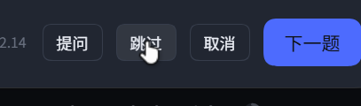

<div align="center">
  

  <h1>DSH Visual Option</h1>

  <p><strong>Turn ASK-USER-QUESTION into something you can see</strong></p>

  <p>
    A plugin for the <a href="https://github.com/deepseek-ai/deepseek-harness">DeepSeek Harness</a> (DSH) Web GUI
    it registers the tool <code>let_user_choose</code>: the model can pass HTML text / links / local paths and ask the user to choose between rendered previews
  </p>

  <p>v0.2.25 · selfcheck 44/44 · MIT</p>

  <p>
    <a href="../README.md">汉语</a> ·
    <a href="./README-CN-Traditional.md">汉语(漢語)</a> ·
    <a href="./README-EN.md">English</a> ·
    <a href="./README-JP.md">にほんご</a> ·
    <a href="./README-ES.md">Español</a> ·
    <a href="./README-FR.md">Français</a>
  </p>
</div>

---

## Before and after

<table>
  <tr>
    <td align="center"><b>visual-option</b></td>
    <td align="center"><b>ask-user-question</b></td>
  </tr>
  <tr>
    <td align="center"></td>
    <td align="center"></td>
  </tr>
</table>

## Why

In a plain chat the model asks "A or B" and the user has to imagine both options
with `let_user_choose` the candidates are rendered as they are: two landing pages side by side, the source of a PHP template, a single confirm button
the user picks one, may attach a note to any option, and the model receives structured data instead of another round of chat

Three steps in total

1. The model calls `let_user_choose` with a question and its candidates
2. The plugin starts a throwaway preview server on this machine and pushes the pending choice to the current session
3. The user picks, annotates and submits, the model receives `{ status, answers[], summary }`

## Features

### Five modes

A request may hold several questions, shown one step at a time, `‹ 1 / 2 ›` at the bottom is the progress
Modes can be mixed in one request

| Mode | What it does |
| --- | --- |
| `single` | exactly one option |
| `multi` | any number of options |
| `fill` | a typed answer |
| `confirm` | two options in one row, one click submits |
| `test` | quiz switch (`test: true`), options marked with `correct: true`, after submit only right/wrong and the score are shown |

<p align="center">
  
</p>

### Previews

- `url` an absolute http(s) page, embedded with a stricter sandbox
- `path` a local page or static file, served by a one-shot preview server with path escape protection
- `inline` inline HTML / PHP source, PHP executed only when configured

### Notes

Every option can carry its own note, returned as `answers[].notes = [{ label, note }]`

<p align="center">
  
</p>

### Hints

An option may carry a `hint`, shown only after the user clicks the small hint button
Which hints were opened comes back as `answers[].hints`, so the model knows which answers were helped

<p align="center">
  
</p>

### Ask back

In any mode, on any step, the user can hit "Ask" and send a sentence back to the main conversation
The dialog closes, the tool returns `status: "asked"` with the question, the model answers in chat and may ask again

<p align="center">
  
</p>

### Other and skip

Every option question has a built-in "Other" box, free text arrives as `answers[].custom`
Any question can be skipped, the answer carries `skipped: true`, required questions included

<p align="center">
  
</p>

### Native dialog

Reuses the GUI theme tokens, mask, radii and focus ring, supports Esc, focus trap and `prefers-reduced-motion`

### Six languages

简体中文 / 繁体中文 / English / にほんご / Español / Français, follow the GUI language or pick one manually

### Preview width

`fit / 768 / 390`, so the same page can be checked on desktop and phone widths

### Prompt guidance

The plugin adds a guidance paragraph to the system prompt: when a choice is needed, default to `let_user_choose` instead of `ask_user_question`, fall back to the native prompt only in special cases, and for anything that is hard to put into words (layout, color scheme, what an error looks like on screen, a data structure, a long code diff) attach an inline HTML source preview to each matching option instead of letting the user imagine it

### Question row in the transcript

That call is no longer a generic tool card in the conversation; it is one row on the same line as the native question: an icon on the left by mode, `mode: title` on the right

| Mode | Icon | Text |
| --- | --- | --- |
| single | question mark in a circle | `Question: <title>` |
| multi | two checkboxes and two lines | `Multi-select: <title>` |
| confirm | a check inside a box | `Confirm: <title>` |
| fill | an input box with two inner lines | `Fill in: <title>` |
| test | two stacked cards | `Quiz: <title>` |

While the request is still pending that row is clickable and reopens the dialog

### Collapse and hold

The `—` in the top right corner of the dialog collapses it into a small pill in the bottom right (icon + mode + title); the request stays pending, and without a result the model does not keep generating. The whole pill is clickable and returns to the dialog; the pill also carries `Cancel` to settle the request right away

> The composer itself is not taken over: DSH's `conversation.composer` is a session-level chain slot that currently only accepts registrations from the built-in UI, a third-party plugin cannot register into it, so you can still type and send messages while the dialog is collapsed — the model is just stuck on that tool call and will not say more

### Replace the native prompt (experimental)

With `replaceAskUserQuestion: true` the plugin registers its tool under the built-in name `ask_user_question`, so every plugin that recognises a question **by tool name** (waiting bubble, notification sound, sidebar grouping, activity text and so on) fires as usual

But there is a prerequisite: the built-in row has to give way first. Measured on `0.2.2-rc.3`, the `tool-ask-user` row sits in the **agent preset `plugins` list**, a profile patch cannot reach it by id (it reports `patch: entry "tool-ask-user" not found`), so the usual route is to **make a custom preset**, drop `tool-ask-user` and then turn this switch on; when the name is taken the plugin falls back to `let_user_choose` and says so in the log

## Settings page

Two entries in settings lead to the same page: the **Choice dialog** entry in the left navigation, and the Settings → Plugins → **Choice dialog** tab. Every feature can be clicked through on the spot:

| Area | What it holds |
| --- | --- |
| Run a test | single / multi / confirm / fill / test buttons, each fires a real request in the session you have open (nobody waits for the result, it settles as soon as you answer) |
| Host settings | `timeoutMs`, `maxInlineBytes`, `phpBinary`, apply as soon as you save and are written to `$DSH_HOME/dsh-visual-option.json`, so they survive a restart |
| Interface | default preview width (`fit / 768 / 390`), whether mode icons show in the chat, kept in the browser |

The host settings only override the same-named values in the patch, the patch stays the baseline; delete that json file to go back to the patch values

## Install

Requires DSH `0.2.0-rc` or newer on the Web profile; best on `0.2.2-rc` and later, where the `agents` service judges the main session with `get` + `session.header.origin`

> [!NOTE]
> The project used to be named `dsh-let-user-choose`. When upgrading, rename the dependency key and the `dsh.profile.bundles` entry to `dsh-visual-option`. The tool name and API paths are unchanged

### Method 1 · dsh plugin market

UI -> Plugins -> Add plugin -> paste one of these

- GitHub: `github:JinSuperOfficial/dsh-visual-option`
- npm: `dsh-visual-option`

### Method 2 · dsh cli

```shell
dsh plugin_manager install_bundle link:/path/to/dsh-visual-option
```

Restart afterwards, or wait for hot-reload to pick it up

### Method 3 · let an agent install it

```prompt-text
Help me to install this plugin: dsh-visual-option
GitHub Repo: `github:JinSuperOfficial/dsh-visual-option`
NPM: `dsh-visual-option`
Or you could look up the repo: "https://github.com/JinSuperOfficial/dsh-visual-option"
Thanks.
```

### Method 4 · manual

Two steps

1. Add the dependency in the profile `package.json` and list it in `dsh.profile.bundles`

   ```json
   {
     "dependencies": { "dsh-visual-option": "link:/path/to/dsh-visual-option" },
     "dsh": { "profile": { "bundles": ["dsh-visual-option"] } }
   }
   ```

2. The bundled `cordis.patch.yml` inserts the `visual-option` node with defaults

## Quick start

Prepare two small HTML files, for example under `preview/` in the session working directory

```html
<!-- preview/a.html -->
<!doctype html>
<html>
  <body style="margin:0;background:#f8f2e9;font-family:serif;padding:24px">
    <h1>Option A</h1>
    <p>Warm editorial</p>
  </body>
</html>
```

```html
<!-- preview/b.html -->
<!doctype html>
<html>
  <body style="margin:0;background:#0b1020;color:#fff;font-family:sans-serif;padding:24px">
    <h1>Option B</h1>
    <p>Cool dashboard</p>
  </body>
</html>
```

A minimal single-choice request

```json
{
  "title": "Pick a landing page",
  "detail": "Both options are below, click one",
  "timeoutSeconds": 600,
  "questions": [
    {
      "id": "plan",
      "question": "Which direction should we take",
      "mode": "single",
      "required": true,
      "options": [
        {
          "label": "Option A · warm editorial",
          "description": "big type with a warm gradient",
          "preview": { "kind": "path", "value": "preview/a.html" }
        },
        {
          "label": "Option B · cool dashboard",
          "description": "data cards with a cool gradient",
          "preview": { "kind": "path", "value": "preview/b.html" }
        }
      ]
    }
  ]
}
```

What the model receives

```json
{
  "status": "answered",
  "answers": [
    {
      "id": "plan",
      "selected": ["Option B · cool dashboard"],
      "notes": [{ "label": "Option A · warm editorial", "note": "tighter layout, a bit heavy on color" }]
    }
  ],
  "summary": "plan: Option B · cool dashboard"
}
```

`status` is `answered` / `cancelled` / `timeout` / `asked`, a timeout carries a `hint`, cancel and timeout carry no `answers`

## Tool parameters

| Field | Type | Notes |
| --- | --- | --- |
| `title` | string | dialog title, defaults to "Choose" |
| `detail` | string | one paragraph under the title |
| `timeoutSeconds` | integer | `30–3600`, defaults to the configured `timeoutMs` (10 minutes) |
| `questions` | array | 1–8 questions |
| `test` | boolean | quiz switch, right/wrong plus score after submit |

**question**

| Field | Type | Notes |
| --- | --- | --- |
| `id` | string | echoed in the answer, unique |
| `question` | string | the question text |
| `header` | string | small heading, optional |
| `detail` | string | extra note, optional |
| `mode` | enum | `single` / `multi` / `fill` / `confirm` |
| `required` | boolean | must be answered before submitting |
| `placeholder` | string | `fill` only |
| `options` | array | options, omit for `fill` |

**option**

| Field | Type | Notes |
| --- | --- | --- |
| `label` | string | returned in the answer, notes are keyed by it |
| `description` | string | one line under the label |
| `preview` | object | `{ kind: "url" \| "path" \| "html" \| "php", value, title? }` |
| `correct` | boolean | marks the right answer in a test |
| `hint` | string | optional hint, revealed on click |

**answers**

| Field | Type | Notes |
| --- | --- | --- |
| `id` | string | question id |
| `selected` | string[] | chosen labels |
| `custom` | string | fill answer, or the "Other" text |
| `hints` | string[] | labels whose hint was opened |
| `skipped` | boolean | the whole question was skipped |
| `notes` | array | `[{ label, note }]` |

Limits: 8 questions, 12 options, labels up to 200 chars, notes up to 1000, fill up to 4000
Unknown fields are rejected and `fill` questions do not take option notes

## Preview details

| kind | render | notes |
| --- | --- | --- |
| `url` | iframe | http(s) only, external hosts get a sandbox without `allow-same-origin` |
| `path` | iframe | relative to the session `cwd`, must stay inside root, file or directory |
| `html` | iframe | inline HTML source, rendered directly |
| `php` | iframe / source | executed when `phpBinary` is configured, otherwise shown as source |

PHP execution has an 8 second timeout and a 2 MiB output cap, errors are not echoed into the page

## Waiting and cancelling

- The countdown starts when the dialog opens
- The first mouse move, click, wheel or key press hides it locally and switches the host to a one hour safety timer
- `Esc`, the close button and "Cancel" end with `cancelled`
- "Ask" ends with `asked`
- Hidden tabs pause polling, returning to the tab refreshes immediately

## Configuration

```yaml
- id: visual-option
  name: dsh-visual-option
  config:
    timeoutMs: 600000
    maxInlineBytes: 65536
    phpBinary: ""
```

## Internal HTTP routes

| Route | Method | Purpose |
| --- | --- | --- |
| `/api/let-user-choose/pending?session=` | GET | pending choice for a session |
| `/api/let-user-choose/answer` | POST | submit, cancel or ask |
| `/api/let-user-choose/hold` | POST | user interacted, drop the timeout |
| `/api/let-user-choose/source` | GET | source preview body |
| `/api/let-user-choose/settings` | GET / POST | read / write host settings from the settings page; POST requires `confirm: true` |
| `/api/let-user-choose/selftest` | POST | settings page test button: fires one real request in that session |

## Security and limits

- The preview server listens on loopback only, so local previews do not load from a remote GUI
- Path previews are realpath checked, `..`, absolute escapes and symlink escapes are rejected
- Inline content has a size cap
- PHP execution is off by default, turning it on runs model supplied code on your machine
- Pages are never uploaded, previews open on your own machine
- A dialog only appears in the session you are looking at, background sessions wait until timeout

## Development

```bash
node selfcheck.mjs
```

Coverage

```
args    → options, notes, timeout bounds, unknown fields
preview → MIME, 404, directory, escapes, symlinks, inline HTML, PHP source and execution
hub     → pending / answer / hold / ask / cancel / timeout / abort / dispose
notes   → round trip, empty notes dropped, fill rejects notes
other   → custom answer without a selection, required checks
skip    → skipping required questions, conflicts rejected
hint    → hint reporting, unknown labels rejected
test    → correct markers, score returned
```

## Project layout

```
dsh-visual-option/
├── index.js            # host plugin: tool registration, /api routes, config
├── client.js           # browser dialog: steps, previews, notes, hints, ask, test
├── lib/
│   ├── args.mjs        # argument validation
│   ├── preview.mjs     # preview server (iframe / source / PHP)
│   └── hub.mjs         # pending requests, timers, hold, answer validation
├── cordis.patch.yml    # mount declaration and defaults
├── selfcheck.mjs       # self test
├── test/fixtures/      # preview fixtures
├── demo/               # acceptance video project
├── assets/             # screenshots used by this README
├── readme/             # translations
├── logo.svg
└── icon.svg
```

## Roadmap

- [ ] publish to npm / dsh plugin market
- [ ] image and PDF previews
- [ ] preview tunnel for remote GUIs
- [ ] tighter PHP sandbox
- [ ] more languages

## License

MIT © JinSuperOfficial

© Jin Xu 2026 · JinSuper™
