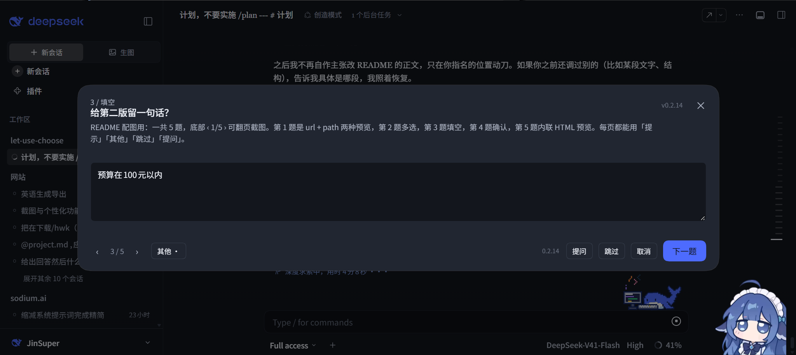
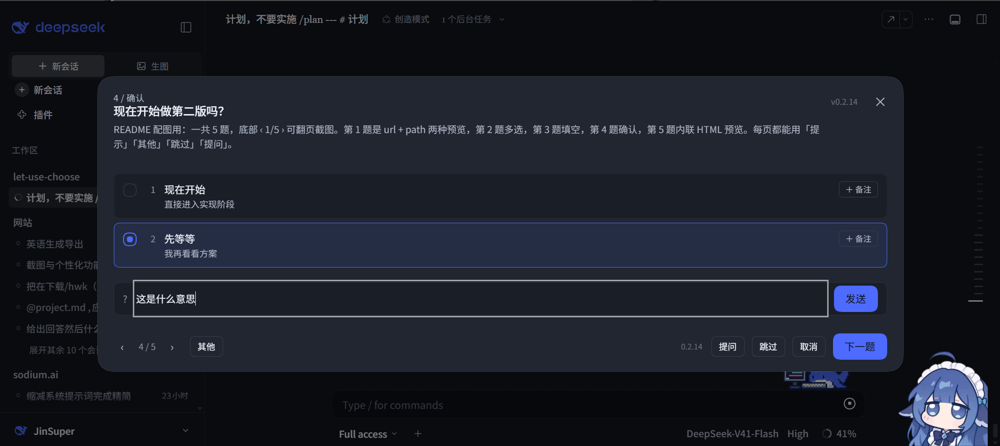
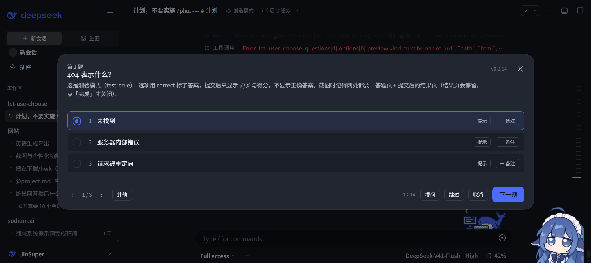
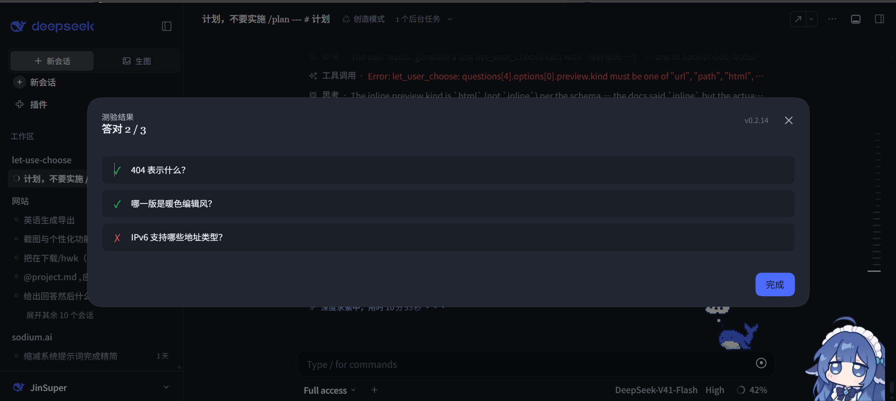

<div align="center">
  

  <h1>DSH Visual Option</h1>

  <p><strong>Convierte ASK-USER-QUESTION en algo que se puede ver</strong></p>

  <p>
    Un plugin para la GUI web de <a href="https://github.com/deepseek-ai/deepseek-harness">DeepSeek Harness</a> (DSH)<br>
    registra la herramienta <code>let_user_choose</code>: el modelo puede pasar texto HTML, enlaces web o rutas locales y plantear al usuario una elección con vista previa
  </p>

  <p>
    <a href="#instalación">Instalación</a> ·
    <a href="#inicio-rápido">Inicio rápido</a> ·
    <a href="#parámetros-de-la-herramienta">Parámetros</a> ·
    <a href="#configuración">Configuración</a> ·
    <a href="#seguridad-y-límites">Seguridad y límites</a>
  </p>

  <p>v0.2.25 · autocomprobación 44/44 · MIT</p>

  <p>
    <a href="../README.md">汉语</a> ·
    <a href="./README-CN-Traditional.md">汉语(漢語)</a> ·
    <a href="./README-EN.md">English</a> ·
    <a href="./README-JP.md">にほんご</a> ·
    <a href="./README-ES.md">Español</a> ·
    <a href="./README-FR.md">Français</a>
  </p>
</div>

---

## Antes y después

<table>
  <tr>
    <td align="center"><b>visual-option (versión visual)</b></td>
    <td align="center"><b>ask-user-question (versión normal)</b></td>
  </tr>
  <tr>
    <td align="center"></td>
    <td align="center"></td>
  </tr>
</table>

## Motivación

En un chat de solo texto el modelo pregunta con `ask_user_question` «¿A o B?» y el usuario todavía tiene que preguntar qué significa eso

`let_user_choose` renderiza las propuestas **tal cual**: dos landing pages en paralelo dentro de dos iframe, el código fuente de una plantilla PHP, un botón de confirmación; el usuario elige, puede añadir una nota a cualquier opción, y el modelo recibe datos estructurados en lugar de otra ronda de conversación

Todo el proceso son solo tres pasos:
1. El modelo llama a `let_user_choose` y entrega la pregunta y las propuestas al plugin
2. El plugin levanta un servicio de vista previa temporal en esta máquina y empuja el contenido candidato al diálogo de la sesión actual
3. El usuario elige, escribe notas y envía; el modelo recibe `{ status, answers[], summary }`

## Características

### Cinco modos

Una petición puede llevar varios problemas y la interfaz muestra uno por paso; `‹ 1 / 2 ›` abajo indica el progreso. Los modos se pueden mezclar en la misma petición, por ejemplo una primera pregunta de opción múltiple y una segunda de texto libre

| Modo | Qué hace |
| --- | --- |
| `single` | exactamente una opción |
| `multi` | cualquier número de opciones |
| `fill` | una respuesta escrita |
| `confirm` | dos opciones en una fila, un clic envía |
| `test` | modo cuestionario (`test: true`), opciones marcadas con `correct: true`; tras enviar solo se muestran aciertos/fallos y la puntuación |

#### 1. Selección única (`single`)
<p align="center">
  
</p>

#### 2. Opción múltiple (`multi`)
<p align="center">
  
</p>

#### 3. Texto libre (`fill`)
<p align="center">
  
</p>

#### 4. Confirmación (`confirm`)
<p align="center">
  
</p>

#### 5. Cuestionario (`test`)
<p align="center">
  <b>Estado de la pregunta:</b><br>
  
</p>
<p align="center">
  <b>Respuesta enviada:</b><br>
  
</p>

### Tres tipos de vista previa

- `url`: cualquier página http(s), directamente en un iframe (los sitios externos usan un sandbox más estricto)
- `path`: página local / archivo estático, servido por un servicio de vista previa de un solo uso que levanta el Host, con protección contra escapes de ruta
- `inline`: código HTML / PHP inline, con ejecución de PHP bajo demanda (configurable)

### Notas por opción
Cada opción admite su propia nota; las notas se devuelven como `answers[].notes = [{ label, note }]`

<p align="center">
  
</p>

### Pistas
Una opción puede llevar `hint`; en la interfaz es un botón pequeño que solo se despliega al pulsarlo. Los hints que el usuario abrió vuelven en `answers[].hints`, así el modelo sabe en qué preguntas se apoyó en una pista

<p align="center">
  
</p>

### Preguntar de vuelta
En cualquier modo y en cualquier paso el usuario puede pulsar «Preguntar» y devolver una frase a la conversación principal: el diálogo se cierra, la herramienta devuelve `status: "asked"` con el texto de la pregunta, el modelo responde en el chat y, si hace falta, vuelve a lanzar la elección

<p align="center">
  
</p>

### Otro y omitir
Cada pregunta de opciones trae un campo «Otro»: si el usuario no quiere elegir una opción existente, escribe su propia respuesta y el texto vuelve en `answers[].custom`. Cada pregunta también se puede omitir; la respuesta lleva `skipped: true`, incluidas las preguntas obligatorias

<p align="center">
  
</p>

### Diálogo nativo
Reutiliza los tokens de tema, la máscara, los radios y el anillo de foco de la GUI; admite Esc para cancelar, focus trap y `prefers-reduced-motion`

### Seis idiomas
Incluye **6 juegos de textos** (chino simplificado, chino tradicional, English, にほんご, Español, Français); puede seguir automáticamente el idioma de la GUI o elegirse a mano en el plugin

### Ancho de la vista previa
El ancho es `ajustar / 768 / 390`, así el mismo contenido se puede revisar a ancho de escritorio o de teléfono

### Guía en el prompt del sistema
El plugin añade una guía al prompt del sistema: cuando hay que pedirle una elección al usuario se usa `let_user_choose` en lugar de `ask_user_question` por defecto, y solo en situaciones especiales se recurre a la pregunta nativa; además, todo lo que el texto no alcanza a explicar (disposición, colores, el estado de un error, estructuras de datos, diferencias largas de código) debe llevar una vista previa con el código HTML inline en la opción correspondiente, en vez de dejar que el usuario lo imagine

### La fila de la pregunta en el historial
En el historial, esa llamada deja de ser una tarjeta genérica de herramienta y pasa a ser una fila como la de la pregunta nativa: a la izquierda, un icono según el modo; a la derecha, `modo: tema`

| Modo | Icono | Texto |
| --- | --- | --- |
| Selección única | signo de interrogación dentro de un círculo | `Pregunta: <título>` |
| Opción múltiple | dos casillas de verificación + dos líneas horizontales | `Pregunta de opción múltiple: <título>` |
| Confirmación | marca de verificación dentro de un cuadro | `Confirmación: <título>` |
| Texto libre | campo de entrada + dos líneas internas | `Texto libre: <título>` |
| Cuestionario | dos tarjetas apiladas | `Cuestionario: <título>` |

Mientras la pregunta sigue pendiente, esta fila se puede pulsar: equivale a reabrir el diálogo

### Plegar y suspender
El `—` de la esquina superior derecha pliega el diálogo en una cápsula pequeña en la esquina inferior derecha (icono + modo + título); la petición sigue pendiente y el modelo no continúa mientras no reciba el resultado. Toda la cápsula se puede pulsar para volver al diálogo; la cápsula también trae `Cancelar` para cerrar directamente

> La barra de entrada no se controla: el `conversation.composer` de DSH es un slot de cadena a nivel de sesión que hoy solo acepta registros de la interfaz integrada, y los plugins de terceros no pueden registrarse; por eso, mientras está plegado, se puede seguir escribiendo y enviando mensajes, solo que el modelo se queda bloqueado en esa llamada de herramienta y no sigue hablando

### Sustituir la pregunta nativa (experimental)
Con `replaceAskUserQuestion: true` el plugin se registra con el nombre integrado `ask_user_question`, así todos los plugins que reconocen las preguntas **por nombre de herramienta** (burbuja de espera, sonido, categoría de la barra lateral, texto de actividad, etc.) se activan como siempre

Pero tiene una condición previa: la fila integrada debe ceder el paso. En pruebas con `0.2.2-rc.3`, la fila `tool-ask-user` está escrita **en la lista `plugins` del agent preset**, y el patch del perfil no la alcanza por id (devuelve `patch: entry "tool-ask-user" not found`), así que lo habitual es **personalizar un preset**: quitar `tool-ask-user` y luego activar este interruptor; si el nombre está ocupado, el plugin vuelve a `let_user_choose` y lo explica en el log

## Página de ajustes

En los ajustes hay dos entradas que llevan a la misma página: **Diálogo de opciones** en la navegación izquierda, y la pestaña **Diálogo de opciones** en Ajustes → Plugins. Allí cada función se puede probar al momento:

| Área | Contenido |
| --- | --- |
| Lanzar una prueba | botones de selección única / opción múltiple / confirmación / texto libre / cuestionario: lanzan una de verdad en la sesión que tengas abierta (nadie espera el resultado; se cierra al responder) |
| Parámetros del servidor | `timeoutMs`, `maxInlineBytes`, `phpBinary`: se aplican al guardar y se persisten en `$DSH_HOME/dsh-visual-option.json`, así que siguen vigentes tras reiniciar |
| Preferencias de interfaz | ancho de vista previa por defecto (ajustar / 768 / 390) y si mostrar los iconos de modo en la conversación; se guardan en el navegador |

Los parámetros del servidor solo sobrescriben la configuración del mismo nombre en el patch, que sigue siendo la base; si borras ese archivo json vuelves a los valores del patch

## Instalación

Requiere DSH `0.2.0-rc` o superior en el perfil web; mejor desde `0.2.2-rc`, donde el servicio `agents` decide la sesión principal con `get` + `session.header.origin`

> [!NOTE]
> El proyecto se llamó antes `dsh-let-user-choose`. Si actualizas desde una versión anterior, cambia el nombre de la dependencia en `package.json` y la entrada de `dsh.profile.bundles` a `dsh-visual-option`; el nombre de la herramienta y las rutas de la API no cambian

### Método 1 · mercado de plugins de dsh

Interfaz → Plugins → Añadir plugin → pega uno de estos:
- GitHub Repo: `github:JinSuperOfficial/dsh-visual-option`
- NPM Publish Repo: `dsh-visual-option`

### Método 2 · dsh cli

```shell
dsh plugin_manager install_bundle link:/path/to/dsh-visual-option
```
Reinicia después de instalar; si tienes hot-reload, espera su aviso

### Método 3 · que lo instale una IA

```prompt-text
Help me to install this plugin: dsh-visual-option
GitHub Repo: `github:JinSuperOfficial/dsh-visual-option`
NPM: `dsh-visual-option`
Or you could look up the repo: "https://github.com/JinSuperOfficial/dsh-visual-option"
Thanks.
```

### Método 4 · manual

Equivale a dos pasos:
1. Añade la dependencia al `package.json` del perfil e inclúyela en `dsh.profile.bundles`:

   ```json
   {
     "dependencies": { "dsh-visual-option": "link:/path/to/dsh-visual-option" },
     "dsh": { "profile": { "bundles": ["dsh-visual-option"] } }
   }
   ```
2. El plugin trae su propio `cordis.patch.yml`, que al cargar inserta el nodo `visual-option` (con la configuración por defecto)

## Inicio rápido

Prepara dos archivos HTML sencillos, por ejemplo en `preview/` dentro del directorio de trabajo de la sesión:

```html
<!-- preview/a.html -->
<!doctype html>
<html>
  <body style="margin:0;background:#f8f2e9;font-family:serif;padding:24px">
    <h1>Option A</h1>
    <p>Warm editorial</p>
  </body>
</html>
```

```html
<!-- preview/b.html -->
<!doctype html>
<html>
  <body style="margin:0;background:#0b1020;color:#fff;font-family:sans-serif;padding:24px">
    <h1>Option B</h1>
    <p>Cool dashboard</p>
  </body>
</html>
```

Una petición mínima de selección única:

```json
{
  "title": "Pick a landing page",
  "detail": "Both options are below, click one",
  "timeoutSeconds": 600,
  "questions": [
    {
      "id": "plan",
      "question": "Which direction should we take",
      "mode": "single",
      "required": true,
      "options": [
        {
          "label": "Option A · warm editorial",
          "description": "big type with a warm gradient",
          "preview": { "kind": "path", "value": "preview/a.html" }
        },
        {
          "label": "Option B · cool dashboard",
          "description": "data cards with a cool gradient",
          "preview": { "kind": "path", "value": "preview/b.html" }
        }
      ]
    }
  ]
}
```

Lo que recibe el modelo:

```json
{
  "status": "answered",
  "answers": [
    {
      "id": "plan",
      "selected": ["Option B · cool dashboard"],
      "notes": [{ "label": "Option A · warm editorial", "note": "tighter layout, a bit heavy on color" }]
    }
  ],
  "summary": "plan: Option B · cool dashboard"
}
```

Valores de `status`: `answered` / `cancelled` / `timeout` / `asked`; el retorno por timeout incluye un `hint`, y ni la cancelación ni el timeout traen `answers`

## Parámetros de la herramienta

| Campo | Tipo | Notas |
| --- | --- | --- |
| `title` | string | título del diálogo, por defecto «Elige / Choose» |
| `detail` | string | un párrafo bajo el título |
| `timeoutSeconds` | integer | `30–3600`, por defecto el `timeoutMs` configurado en el plugin (10 minutos) |
| `questions` | array | 1–8 preguntas, ver abajo |
| `test` | boolean | interruptor de cuestionario; tras enviar solo devuelve aciertos/fallos y puntuación |

**question**

| Campo | Tipo | Notas |
| --- | --- | --- |
| `id` | string | se devuelve en la respuesta, único |
| `question` | string | texto de la pregunta |
| `header` | string | encabezado corto (opcional) |
| `detail` | string | nota adicional (opcional) |
| `mode` | enum | `single` / `multi` / `fill` / `confirm` |
| `required` | boolean | obligatoria; si falta, se avisa abajo y no se permite enviar |
| `placeholder` | string | solo para `fill` |
| `options` | array | opciones; en `fill` debe ir vacío o no enviarse |

**option**

| Campo | Tipo | Notas |
| --- | --- | --- |
| `label` | string | nombre de la opción (las notas se indexan por él) |
| `description` | string | descripción de la opción (opcional) |
| `preview` | object | `{ kind: "url" \| "path" \| "inline", value, title? }` |
| `correct` | boolean | marca la respuesta correcta en modo cuestionario |
| `hint` | string | pista opcional, se despliega con el botón «Pista» |

**answers**

| Campo | Tipo | Notas |
| --- | --- | --- |
| `id` | string | id de la pregunta correspondiente |
| `selected` | string[] | labels de las opciones elegidas |
| `custom` | string | respuesta de texto libre, o el texto escrito en «Otro» |
| `hints` | string[] | labels cuyos hints abrió el usuario |
| `skipped` | boolean | pregunta omitida por completo |
| `notes` | array | `[{ label, note }]` notas por opción |

> [!IMPORTANT]
> Límites: preguntas ≤ 8, opciones ≤ 12, `label` ≤ 200 caracteres, notas ≤ 1000 caracteres, texto libre ≤ 4000 caracteres; los campos desconocidos se rechazan, y las preguntas `fill` no aceptan notas por opción

**Una convención sobre los modos**
- Con una sola pregunta, `confirm` envía al hacer clic
- Con varias preguntas, `confirm` es solo una fila de dos opciones y sigue haciendo falta pulsar enviar
- En modo cuestionario cada pregunta necesita al menos un `correct: true`; tras enviar se devuelve `score: { correct, total }`
- Las respuestas de todos los modos van en `answers[]` indexadas por `id`

## Detalles de la vista previa

| kind | render | notas |
| --- | --- | --- |
| `url` | iframe | solo `http(s)`; los dominios externos usan un sandbox sin `allow-same-origin` |
| `path` | iframe | las rutas relativas se resuelven contra el `cwd` de la sesión y deben quedar dentro del root; puede apuntar a un archivo o a un directorio |
| `inline` | iframe / código fuente | el HTML inline se renderiza directamente; `inline` + PHP con `phpBinary` configurado se ejecuta y se renderiza la salida, si no se muestra el código fuente |

**Comportamiento de PHP**
- `phpBinary: ""` (por defecto): solo se muestra el código fuente, con la etiqueta «Vista previa del código (PHP no ejecutado)»
- `phpBinary: "auto"`: detecta `php` en `PATH` y lo ejecuta si lo encuentra
- Cualquier otro valor: se trata como ruta a un ejecutable
- La ejecución tiene un timeout de 8 segundos y un límite de salida de 2 MiB; los errores no se muestran en la página

**Servicio de vista previa**
- Cada petición levanta su propio `http.createServer`, atado a `127.0.0.1:0` (puerto aleatorio)
- Los documentos inline se sirven en `/<token>.html`, los archivos estáticos en `/`, con token aleatorio
- Tras responder / cancelar / expirar se cierra con retardo y se recupera el puerto

## Espera y cancelación

- Al abrirse el diálogo empieza la cuenta atrás (`restante m:ss`)
- El primer movimiento de ratón, clic, rueda o tecla del usuario hace que el cliente oculte la cuenta atrás en local y envíe un POST a `/api/let-user-choose/hold`; el Host sustituye el temporizador por uno de seguridad de 1 hora
- `Esc`, la `×` de arriba a la derecha y «Cancelar» abajo terminan con `cancelled`
- «Preguntar» termina con `asked` y devuelve la pregunta a la conversación principal
- Con la pestaña en segundo plano el polling se pausa; al volver a primer plano se consulta de inmediato
- Un timeout termina con `timeout`

## Configuración

Se escribe en el nodo del plugin (el insert de `cordis.patch.yml` o la capa de patch del perfil):

```yaml
- id: visual-option
  name: dsh-visual-option
  config:
    timeoutMs: 600000
    maxInlineBytes: 65536
    phpBinary: ""
```

`timeoutMs` es el límite de espera en milisegundos (entre 5 s y 1 h), `maxInlineBytes` el tamaño máximo de un bloque html/php inline y `phpBinary` decide cómo se ejecuta PHP (`""`, `"auto"` o la ruta de un ejecutable)

## Rutas HTTP internas

El diálogo del cliente y el Host solo se comunican por el canal `/api` que ya trae la GUI:

| Ruta | Método | Función |
| --- | --- | --- |
| `/api/let-user-choose/pending?session=` | GET | si la sesión actual tiene una elección pendiente |
| `/api/let-user-choose/answer` | POST | enviar respuesta / cancelar / preguntar |
| `/api/let-user-choose/hold` | POST | el usuario ya interactuó, se anula el límite de tiempo |
| `/api/let-user-choose/source` | GET | contenido de la vista previa de código fuente |
| `/api/let-user-choose/settings` | GET/POST | lee y escribe los ajustes del host desde la página de ajustes; POST requiere `confirm: true` |
| `/api/let-user-choose/selftest` | POST | botón de prueba: crea una petición real en esa sesión |

## Seguridad y límites

- El servicio de vista previa solo escucha en loopback: si abres la GUI desde otra máquina, las vistas previas locales no cargan (el diálogo avisa), aunque las vistas `url` externas siguen funcionando
- Las vistas `path` se validan con realpath y rechazan `..`, escapes a rutas absolutas y escapes por enlaces simbólicos
- El contenido inline tiene un límite de tamaño; si se supera se rechaza
- Las páginas de referencia no se suben a ningún sitio: la vista previa se abre solo en tu máquina
- El diálogo solo aparece en la sesión que estás viendo; las llamadas de sesiones en segundo plano esperan hasta el timeout

> [!WARNING]
> La ejecución de PHP está desactivada por defecto; activarla (por ejemplo `phpBinary: "auto"`) significa permitir que el código que aporta el modelo se ejecute en tu máquina, con riesgo de ejecución remota de código (RCE). Valóralo y úsalo en un entorno controlado

## Desarrollo

```bash
node selfcheck.mjs
```

La autocomprobación cubre:

```
args    → options, notes, timeout bounds, unknown fields
preview → MIME, 404, directory, escapes, symlinks, inline HTML, PHP source and execution
hub     → pending / answer / hold / ask / cancel / timeout / abort / dispose
notes   → round trip, empty notes dropped, fill rejects notes
other   → custom answer without a selection, required checks
skip    → skipping required questions, conflicts rejected
hint    → hint reporting, unknown labels rejected
test    → correct markers, score returned
```

El proyecto del vídeo de aceptación está en `demo/` (Electron con render offscreen + `client.js` real + captura de frames y composición):

```bash
cd demo
npm install
python3 -m http.server 4610 --bind 127.0.0.1 &
~/.dsh/electron/electron app      # graba en demo/out/frames/
node encode.mjs                   # compone demo/out/acceptance.mp4
```

## Estructura del proyecto

```
dsh-visual-option/
├── index.js            # host plugin: tool registration, /api routes, config
├── client.js           # browser dialog: steps, previews, notes, hints, ask, test
├── lib/
│   ├── args.mjs        # argument validation
│   ├── preview.mjs     # preview server (iframe / source / PHP)
│   └── hub.mjs         # pending requests, timers, hold, answer validation
├── cordis.patch.yml    # mount declaration and defaults
├── selfcheck.mjs       # self test
├── test/fixtures/      # preview fixtures
├── demo/               # acceptance video project
├── assets/             # screenshots used by this README
├── readme/             # translations
├── logo.svg
└── icon.svg
```

## Roadmap

- [ ] publicar en npm / mercado de plugins de dsh
- [ ] vista previa de imágenes (`png/jpg`) y PDF
- [ ] túnel de vista previa para acceso remoto (hoy solo local)
- [ ] sandbox de PHP más fino (timeout, funciones deshabilitadas, solo lectura)
- [ ] más idiomas

## License

MIT © JinSuperOfficial

© Jin Xu 2026 · JinSuper™
