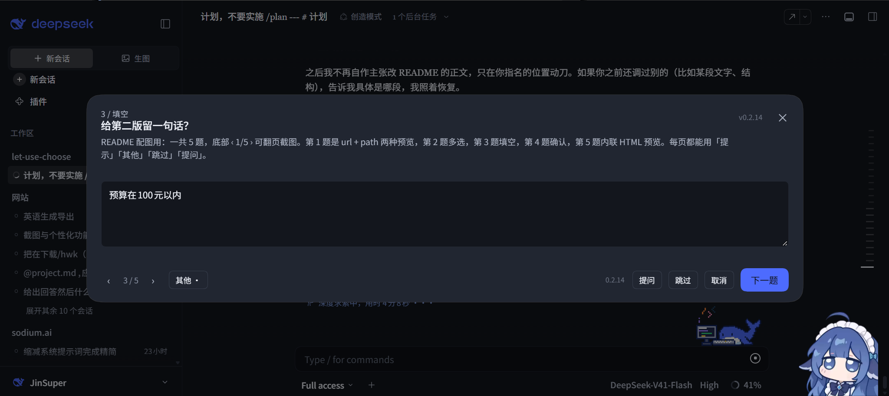
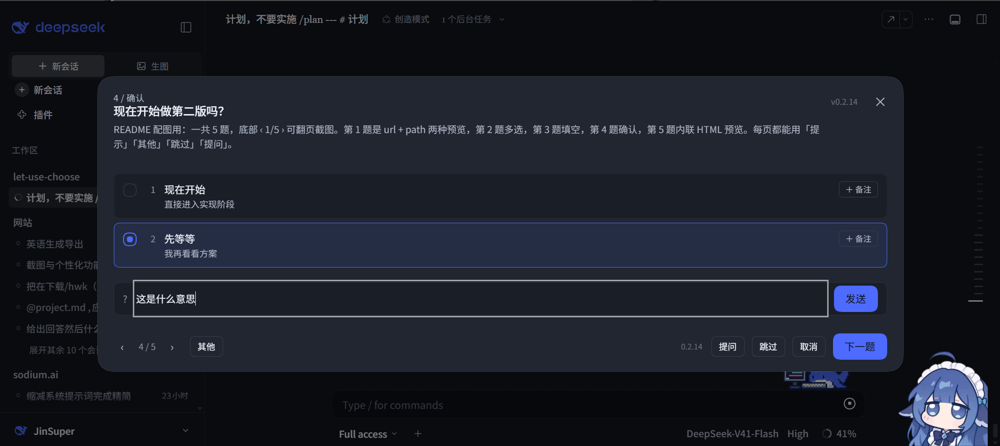
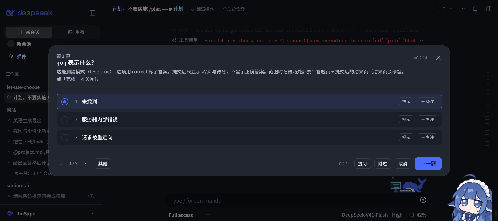
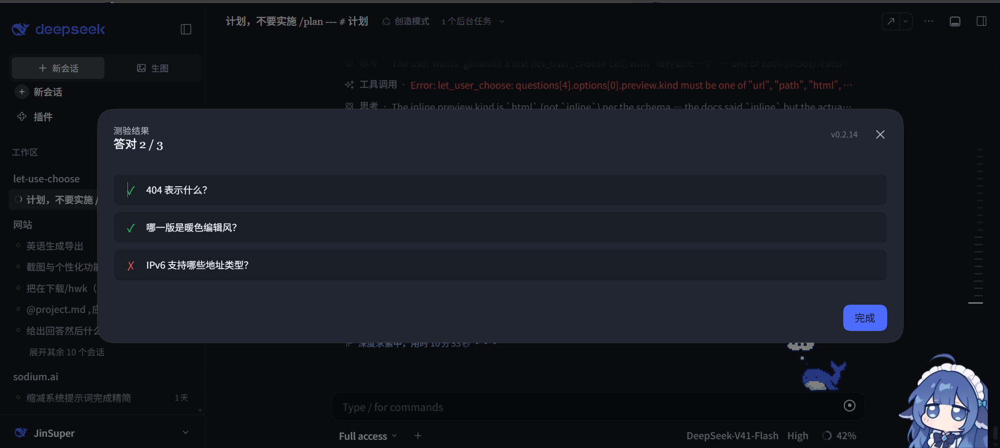

<div align="center">
  

  <h1>DSH Visual Option</h1>

  <p><strong>Faire de ASK-USER-QUESTION quelque chose de visible</strong></p>

  <p>
    Un plugin pour le GUI Web de <a href="https://github.com/deepseek-ai/deepseek-harness">DeepSeek Harness</a> (DSH)<br>
    qui enregistre l'outil <code>let_user_choose</code> : le modèle peut passer du texte HTML / un lien / un chemin local et proposer à l'utilisateur un choix avec aperçu
  </p>

  <p>
    <a href="#installation">Installation</a> ·
    <a href="#démarrage-rapide">Démarrage rapide</a> ·
    <a href="#paramètres-de-loutil">Paramètres de l'outil</a> ·
    <a href="#configuration">Configuration</a> ·
    <a href="#sécurité-et-limites">Sécurité et limites</a>
  </p>

  <p>v0.2.25 · auto-test 44/44 · MIT</p>

  <p>
    <a href="../README.md">汉语</a> ·
    <a href="./README-CN-Traditional.md">汉语(漢語)</a> ·
    <a href="./README-EN.md">English</a> ·
    <a href="./README-JP.md">にほんご</a> ·
    <a href="./README-ES.md">Español</a> ·
    <a href="./README-FR.md">Français</a>
  </p>
</div>

---

## Comparaison

<Vidéo Bilibili intégrée, à remplacer plus tard><vidéo>
<Vidéo YouTube intégrée><vidéo>

<table>
  <tr>
    <td align="center"><b>visual-option (version visuelle)</b></td>
    <td align="center"><b>ask-user-question (version texte)</b></td>
  </tr>
  <tr>
    <td align="center"></td>
    <td align="center"></td>
  </tr>
</table>

## L'inspiration

Dans une conversation en texte brut, le modèle pose « A ou B » avec `ask_user_question`, et l'utilisateur doit souvent demander ce que cela veut dire

`let_user_choose` rend les candidats **tels quels** : deux landing pages côte à côte en iframe, la source d'un template PHP, un simple bouton de confirmation. L'utilisateur choisit, peut attacher une note à n'importe quelle option, et le modèle reçoit des données structurées au lieu d'un nouveau tour de conversation

Trois étapes en tout :
1. Le modèle appelle `let_user_choose` avec la question et les candidats
2. Le plugin lance un serveur de prévisualisation temporaire sur la machine et pousse le choix en attente vers la session courante
3. L'utilisateur clique, annote, valide, et le modèle reçoit `{ status, answers[], summary }`

## Fonctionnalités

### Cinq modes

Une requête peut contenir plusieurs questions ; l'interface affiche une question à la fois, avec `‹ 1 / 2 ›` en bas pour la progression. Les modes peuvent se mélanger dans une même requête, par exemple une première question en choix multiple et une seconde en saisie libre

| Mode | Ce qu'il fait |
| --- | --- |
| `single` | exactement une option |
| `multi` | un nombre quelconque d'options |
| `fill` | une réponse saisie au clavier |
| `confirm` | deux options sur une ligne, un clic pour valider |
| `test` | mode quiz (`test: true`), options marquées avec `correct: true`, après validation seuls le juste/faux et le score sont affichés |

#### 1. Choix unique (single)
<p align="center">
  
</p>

#### 2. Choix multiple (multi)
<p align="center">
  
</p>

#### 3. Saisie libre (fill)
<p align="center">
  
</p>

#### 4. Confirmation (confirm)
<p align="center">
  
</p>

#### 5. Quiz (test)
<p align="center">
  <b>État de la question :</b><br>
  
</p>
<p align="center">
  <b>Après envoi :</b><br>
  
</p>

### Trois types de prévisualisation

- `url` : n'importe quelle page http(s), en iframe direct (sandbox plus stricte pour les sites externes)
- `path` : page locale ou fichier statique, servi par un serveur de prévisualisation éphémère lancé par le Host, avec protection contre les sorties de chemin
- `inline` : source HTML / PHP inline, PHP exécuté à la demande (configurable)

### Notes par option

Chaque option peut porter sa propre note, renvoyée via `answers[].notes = [{ label, note }]`

<p align="center">
  
</p>

### Indices

Une option peut porter un `hint` : un petit bouton dans l'interface, qui n'affiche le texte qu'au clic. Les indices ouverts sont renvoyés dans `answers[].hints`, le modèle sait donc quelles réponses ont été aidées

<p align="center">
  
</p>

### Question en retour

Dans n'importe quel mode, à n'importe quelle étape, l'utilisateur peut cliquer sur « Question » et renvoyer une phrase dans la conversation principale : la fenêtre se ferme, l'outil retourne `status: "asked"` avec le texte de la question, le modèle répond dans le chat puis relance le choix si nécessaire

<p align="center">
  
</p>

### Autre et passer

Chaque question à options embarque un champ « Autre » : si l'utilisateur ne veut aucune des propositions, il peut écrire directement sa réponse, renvoyée dans `answers[].custom`. Chaque question peut aussi être passée, la réponse porte alors `skipped: true`, y compris pour les questions obligatoires

<p align="center">
  
</p>

### Fenêtre native

Réutilise les variables de thème du GUI, le masque, les rayons et l'anneau de focus ; prend en charge Échap, le piège de focus et `prefers-reduced-motion`

### Multilingue

**6 jeux de libellés** intégrés (简体中文, 繁体中文, English, にほんご, Español, Français), qui suivent automatiquement la langue du GUI ou se choisissent à la main dans le plugin

### Largeur adaptative

Largeur de prévisualisation au choix : `fit / 768 / 390` — le même contenu peut être vérifié en largeur desktop ou mobile

### Consigne dans le prompt système

Le plugin ajoute une consigne au prompt système : quand il faut faire choisir l'utilisateur, passer par `let_user_choose` plutôt que par `ask_user_question`, et ne revenir à la question native que dans des cas particuliers ; tout ce qui ne s'explique pas par du texte (mise en page, palette, capture d'erreur, structure de données, longue différence de code) doit fournir un aperçu HTML inline sur l'option concernée, au lieu de laisser l'utilisateur l'imaginer

### La ligne de question dans l'historique

Dans l'historique de la conversation, cet appel n'est plus une carte d'outil générique, mais une ligne au même rang que la question native : l'icône du mode à gauche, `mode : sujet` à droite

| Mode | Icône | Libellé |
| --- | --- | --- |
| `single` | un point d'interrogation dans un cercle | `Question : <titre>` |
| `multi` | deux cases à cocher + deux traits | `Choix multiple : <titre>` |
| `confirm` | une coche dans un cadre | `Confirmation : <titre>` |
| `fill` | un champ de saisie + deux traits | `Saisie libre : <titre>` |
| `test` | deux cartes superposées | `Quiz : <titre>` |

Cette ligne est cliquable tant que la question est en attente : un clic rouvre la fenêtre

### Replier et suspendre

Le `—` en haut à droite replie la fenêtre en une petite pastille dans le coin inférieur droit (icône + mode + titre) ; la requête reste en attente, et le modèle, sans résultat, ne continue pas à répondre. Toute la pastille est cliquable pour revenir à la fenêtre ; elle porte aussi `Annuler` pour conclure directement

> La zone de saisie n'est pas reprise : `conversation.composer` de DSH est un emplacement « chain » au niveau de la session, qui n'accepte aujourd'hui que les enregistrements de l'UI intégrée, pas ceux d'un plugin tiers ; pendant que la fenêtre est repliée, vous pouvez donc toujours taper et envoyer des messages, le modèle restant simplement bloqué sur cet appel d'outil sans continuer à parler

### Remplacer la question native (expérimental)

Avec `replaceAskUserQuestion: true`, le plugin enregistre l'outil sous le nom intégré `ask_user_question`, de sorte que tous les plugins qui reconnaissent une question **par nom d'outil** (bulle d'attente, son de notification, classement dans la barre latérale, texte d'activité, etc.) se déclenchent comme d'habitude

Cela suppose toutefois une condition : la ligne intégrée doit d'abord céder la place. Sur `0.2.2-rc.3`, la ligne `tool-ask-user` figure dans la **liste `plugins` de l'agent preset**, et le patch du profil ne peut pas l'atteindre par id (erreur `patch: entry "tool-ask-user" not found`) ; la démarche habituelle est donc de **dupliquer un preset**, d'en retirer `tool-ask-user`, puis d'activer ce commutateur. Si le nom est déjà pris, le plugin retombe sur `let_user_choose` et l'explique dans les logs

## Page de réglages

Deux entrées des réglages pointent vers la même page : **Choix visuels** dans la navigation de gauche, et l'onglet Paramètres → Plugins → **Choix visuels**. On peut y essayer chaque fonction point par point :

| Zone | Contenu |
| --- | --- |
| Lancer un test | cinq boutons single / multi / confirm / fill / test, qui affichent vraiment une fenêtre dans la session ouverte (personne n'attend le résultat, la fenêtre se referme après la réponse) |
| Paramètres serveur | `timeoutMs`, `maxInlineBytes`, `phpBinary` ; appliqués dès l'enregistrement et écrits dans `$DSH_HOME/dsh-visual-option.json`, donc toujours valables après un redémarrage |
| Préférences d'interface | largeur d'aperçu par défaut (fit / 768 / 390) et affichage ou non de l'icône de mode dans la conversation ; stockées dans le navigateur |

Les paramètres serveur ne remplacent que les configurations de même nom du patch, le patch reste la base : supprimer ce fichier json ramène aux valeurs du patch

## Installation

Nécessite DSH `0.2.0-rc` ou plus récent sur le profil web ; idéalement `0.2.2-rc` et au-delà, où le service `agents` détermine la session principale avec `get` et `session.header.origin`

> [!NOTE]
> Le projet s'est appelé `dsh-let-user-choose`. Si vous mettez à jour depuis une ancienne version, pensez à renommer la dépendance dans `package.json` et l'entrée dans `dsh.profile.bundles` en `dsh-visual-option` ; le nom de l'outil et les routes API ne changent pas

### Méthode 1 · marché de plugins dsh

Interface principale -> Plugins -> Ajouter un plugin -> collez le lien du plugin :
- GitHub Repo : `github:JinSuperOfficial/dsh-visual-option`
- NPM Publish Repo : `dsh-visual-option`

### Méthode 2 · dsh cli

```shell
dsh plugin_manager install_bundle link:/path/to/dsh-visual-option
```
Redémarrez après l'installation ; si le hot-reload est actif, attendez simplement qu'il vous le signale

### Méthode 3 · laisser l'IA l'installer

```prompt-text
Help me to install this plugin: dsh-visual-option
GitHub Repo: `github:JinSuperOfficial/dsh-visual-option`
NPM: `dsh-visual-option`
Or you could look up the repo: "https://github.com/JinSuperOfficial/dsh-visual-option"
Thanks.
```

### Méthode 4 · installation manuelle

Deux étapes équivalentes :
1. Ajoutez la dépendance au `package.json` du profil et listez-la dans `dsh.profile.bundles` :

   ```json
   {
     "dependencies": { "dsh-visual-option": "link:/path/to/dsh-visual-option" },
     "dsh": { "profile": { "bundles": ["dsh-visual-option"] } }
   }
   ```
2. Le `cordis.patch.yml` fourni insère le nœud `visual-option` au chargement (avec la configuration par défaut)

## Démarrage rapide

Préparez deux petits fichiers HTML, par exemple dans `preview/` du répertoire de travail de la session :

```html
<!-- preview/a.html -->
<!doctype html>
<html>
  <body style="margin:0;background:#f8f2e9;font-family:serif;padding:24px">
    <h1>Option A</h1>
    <p>Warm editorial</p>
  </body>
</html>
```

```html
<!-- preview/b.html -->
<!doctype html>
<html>
  <body style="margin:0;background:#0b1020;color:#fff;font-family:sans-serif;padding:24px">
    <h1>Option B</h1>
    <p>Cool dashboard</p>
  </body>
</html>
```

Une requête de choix unique minimale :

```json
{
  "title": "Pick a landing page",
  "detail": "Both options are below, click one",
  "timeoutSeconds": 600,
  "questions": [
    {
      "id": "plan",
      "question": "Which direction should we take",
      "mode": "single",
      "required": true,
      "options": [
        {
          "label": "Option A · warm editorial",
          "description": "big type with a warm gradient",
          "preview": { "kind": "path", "value": "preview/a.html" }
        },
        {
          "label": "Option B · cool dashboard",
          "description": "data cards with a cool gradient",
          "preview": { "kind": "path", "value": "preview/b.html" }
        }
      ]
    }
  ]
}
```

Ce que le modèle reçoit en retour :

```json
{
  "status": "answered",
  "answers": [
    {
      "id": "plan",
      "selected": ["Option B · cool dashboard"],
      "notes": [{ "label": "Option A · warm editorial", "note": "tighter layout, a bit heavy on color" }]
    }
  ],
  "summary": "plan: Option B · cool dashboard"
}
```

Valeurs de `status` : `answered` / `cancelled` / `timeout` / `asked`. Un timeout renvoie un `hint` ; l'annulation et le timeout ne renvoient pas `answers`

## Paramètres de l'outil

| Champ | Type | Description |
| --- | --- | --- |
| `title` | string | titre de la fenêtre, « Choisir / Choose » par défaut |
| `detail` | string | un paragraphe explicatif sous le titre |
| `timeoutSeconds` | integer | `30–3600`, par défaut le `timeoutMs` de la configuration du plugin (10 minutes) |
| `questions` | array | 1 à 8 questions, voir ci-dessous |
| `test` | boolean | active le quiz : après envoi, seuls le juste/faux et le score sont renvoyés |

**question**

| Champ | Type | Description |
| --- | --- | --- |
| `id` | string | sert à renvoyer la réponse, unique |
| `question` | string | texte de la question |
| `header` | string | petit titre (facultatif) |
| `detail` | string | précision complémentaire (facultatif) |
| `mode` | enum | `single` / `multi` / `fill` / `confirm` |
| `required` | boolean | obligatoire ; sinon indication en bas et envoi bloqué |
| `placeholder` | string | uniquement pour `fill` |
| `options` | array | options ; pour `fill`, doit être vide ou absent |

**option**

| Champ | Type | Description |
| --- | --- | --- |
| `label` | string | nom de l'option (sert aussi de clé pour les notes) |
| `description` | string | description de l'option (facultatif) |
| `preview` | object | `{ kind: "url" \| "path" \| "inline", value, title? }` |
| `correct` | boolean | marque la bonne réponse en mode quiz |
| `hint` | string | indice facultatif, dévoilé via « Indice » |

**answers**

| Champ | Type | Description |
| --- | --- | --- |
| `id` | string | id de la question correspondante |
| `selected` | string[] | label des options choisies |
| `custom` | string | réponse de saisie libre, ou texte écrit dans « Autre » |
| `hints` | string[] | label des options dont l'indice a été ouvert |
| `skipped` | boolean | question passée en entier |
| `notes` | array | `[{ label, note }]` notes par option |

> [!IMPORTANT]
> Limites : 8 questions max, 12 options max, `label` ≤ 200 caractères, note ≤ 1000 caractères, saisie libre ≤ 4000 caractères ; les champs inconnus sont rejetés ; une question `fill` n'accepte pas de notes d'option

**Quelques conventions sur les modes**
- `confirm` avec une seule question : le clic sélectionne et valide
- avec plusieurs questions, `confirm` n'est qu'une ligne à deux choix, il faut encore valider
- en mode quiz, chaque question doit avoir au moins un `correct: true` ; la réponse contient alors `score: { correct, total }`
- quel que soit le mode, les réponses sont dans `answers[]`, indexées par `id`

## Détails des prévisualisations

| kind | rendu | description |
| --- | --- | --- |
| `url` | iframe | `http(s)` uniquement ; les domaines externes utilisent un sandbox sans `allow-same-origin` |
| `path` | iframe | chemin relatif résolu depuis le `cwd` de la session, doit rester dans la racine ; fichier seul ou répertoire |
| `inline` | iframe / source | HTML inline rendu directement ; `inline` + PHP avec `phpBinary` configuré exécute et affiche la sortie, sinon montre la source |

**Comportement de PHP**
- `phpBinary: ""` (par défaut) — la source seule, avec le libellé « Aperçu source (PHP non exécuté) »
- `phpBinary: "auto"` — détecte `php` dans le `PATH` et l'exécute s'il est trouvé
- toute autre valeur — traitée comme le chemin d'un exécutable
- l'exécution a un timeout de 8 secondes et une sortie plafonnée à 2 MiB ; les erreurs ne sont pas réaffichées dans la page

**Serveur de prévisualisation**
- un `http.createServer` indépendant par requête, lié à `127.0.0.1:0` (port aléatoire)
- document inline servi sur `/<token>.html`, fichiers statiques sur `/`, token aléatoire
- fermeture différée après réponse / annulation / timeout, puis le port est libéré

## Attente et annulation

- le compte à rebours démarre à l'ouverture de la fenêtre (`reste m:ss`)
- au premier mouvement de souris, clic, molette ou frappe clavier → le client masque le compteur localement et envoie un POST `/api/let-user-choose/hold` ; le Host remplace le minuteur par un filet de sécurité d'une heure
- `Échap`, le `×` en haut à droite et « Annuler » terminent en `cancelled`
- « Question » termine en `asked` et renvoie la question dans la conversation principale
- onglet en arrière-plan : le polling se met en pause et reprend immédiatement au retour
- le timeout termine en `timeout`

## Configuration

Dans le nœud du plugin (`insert` de `cordis.patch.yml` ou couche patch du profil) :

```yaml
- id: visual-option
  name: dsh-visual-option
  config:
    timeoutMs: 600000
    maxInlineBytes: 65536
    phpBinary: ""
```

- `timeoutMs` : attente maximale par défaut (en millisecondes), bornée entre 5 s et 1 h
- `maxInlineBytes` : taille maximale d'un contenu html/php inline
- `phpBinary` : `""` / `"auto"` / chemin d'un exécutable

## Routes HTTP (internes)

La fenêtre cliente et le Host ne communiquent que par le canal `/api` fourni par le GUI :

| Route | Méthode | Rôle |
| --- | --- | --- |
| `/api/let-user-choose/pending?session=` | GET | y a-t-il un choix en attente pour la session |
| `/api/let-user-choose/answer` | POST | envoi de la réponse / annulation / question |
| `/api/let-user-choose/hold` | POST | l'utilisateur a interagi, on retire la limite de temps |
| `/api/let-user-choose/source` | GET | contenu de l'aperçu source |
| `/api/let-user-choose/settings` | GET / POST | lecture et écriture des réglages de l'hôte depuis la page de réglages ; `POST` exige `confirm: true` |
| `/api/let-user-choose/selftest` | POST | bouton de test : crée une vraie requête dans cette session |

## Sécurité et limites

- le serveur de prévisualisation n'écoute que sur l'adresse de bouclage : depuis une autre machine, les aperçus locaux ne se chargent pas (la fenêtre l'indique), les aperçus `url` externes restent disponibles
- les aperçus de type `path` sont validés par realpath : `..`, échappement par chemin absolu et par lien symbolique sont refusés
- le contenu inline a une taille maximale ; au-delà, il est refusé
- les pages de référence ne sont jamais téléversées, les aperçus ne s'ouvrent que sur votre machine
- la fenêtre ne s'affiche que dans la session en cours de consultation ; un appel depuis une session en arrière-plan attend jusqu'au timeout

> [!WARNING]
> L'exécution PHP est désactivée par défaut ; l'activer (par exemple `phpBinary: "auto"`) revient à autoriser du code fourni par le modèle à s'exécuter sur votre machine, avec un risque d'exécution de code à distance (RCE). À évaluer et à réserver à un environnement contrôlé

## Développement

```bash
node selfcheck.mjs
```

L'auto-test couvre :

```
args    → options, notes, timeout bounds, unknown fields
preview → MIME, 404, directory, escapes, symlinks, inline HTML, PHP source and execution
hub     → pending / answer / hold / ask / cancel / timeout / abort / dispose
notes   → round trip, empty notes dropped, fill rejects notes
other   → custom answer without a selection, required checks
skip    → skipping required questions, conflicts rejected
hint    → hint reporting, unknown labels rejected
test    → correct markers, score returned
```

Le projet de la vidéo de validation se trouve dans `demo/` (rendu Electron offscreen + vrai `client.js` + composition des frames) :

```bash
cd demo
npm install
python3 -m http.server 4610 --bind 127.0.0.1 &
~/.dsh/electron/electron app      # enregistre dans demo/out/frames/
node encode.mjs                   # assemble demo/out/acceptance.mp4
```

## Structure du projet

```
dsh-visual-option/
├── index.js            # host plugin: tool registration, /api routes, config
├── client.js           # browser dialog: steps, previews, notes, hints, ask, test
├── lib/
│   ├── args.mjs        # argument validation
│   ├── preview.mjs     # preview server (iframe / source / PHP)
│   └── hub.mjs         # pending requests, timers, hold, answer validation
├── cordis.patch.yml    # mount declaration and defaults
├── selfcheck.mjs       # self test
├── test/fixtures/      # preview fixtures
├── demo/               # acceptance video project
├── assets/             # screenshots used by this README
├── readme/             # translations
├── logo.svg
└── icon.svg
```

## Roadmap

- [ ] publication sur npm / le marché de plugins dsh
- [ ] aperçus d'images (`png/jpg`) et de PDF
- [ ] tunnel de prévisualisation pour l'accès distant (aujourd'hui limité à la machine locale)
- [ ] sandbox PHP plus fine (timeout, fonctions désactivées, lecture seule)
- [ ] davantage de langues

## Licence

MIT © JinSuperOfficial

© Jin Xu 2026 · JinSuper™
