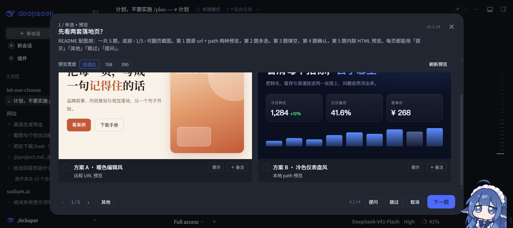
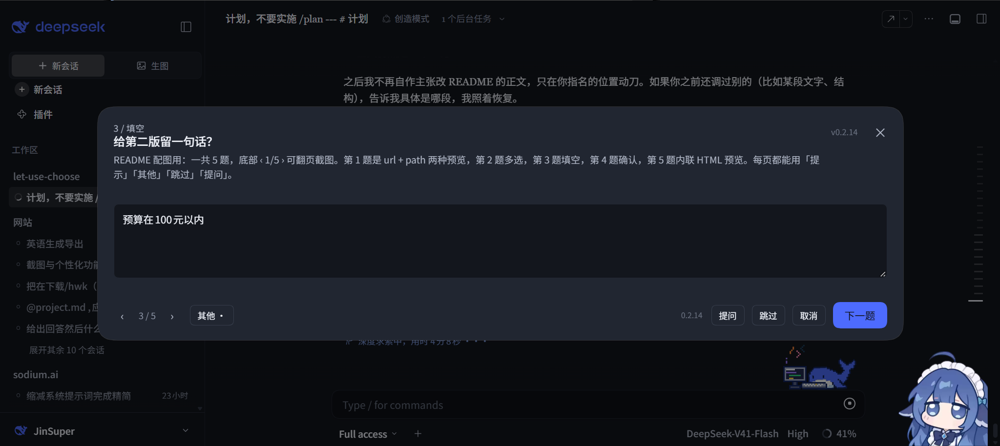
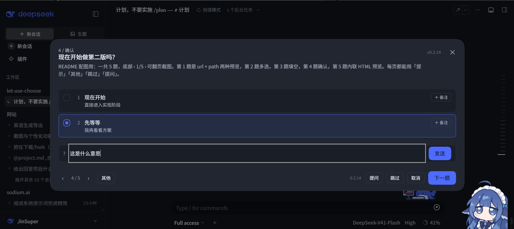
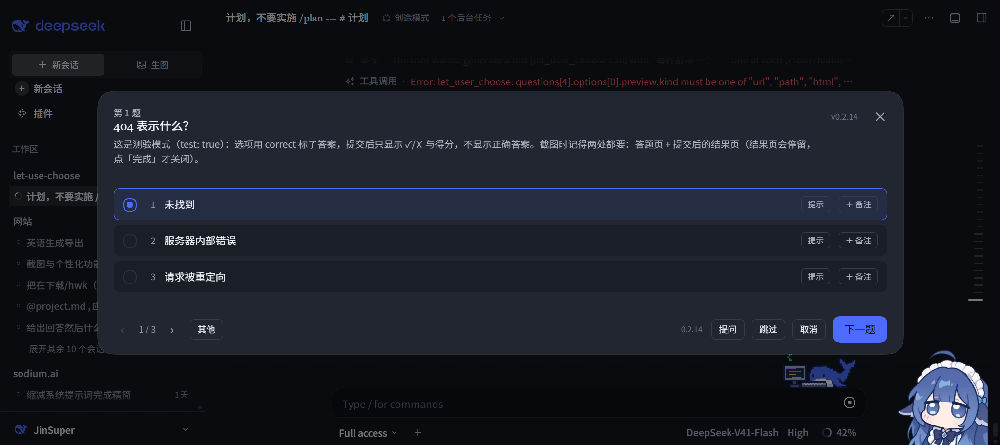
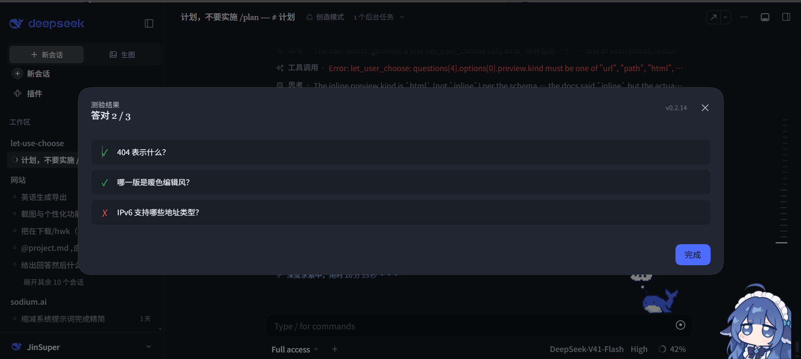
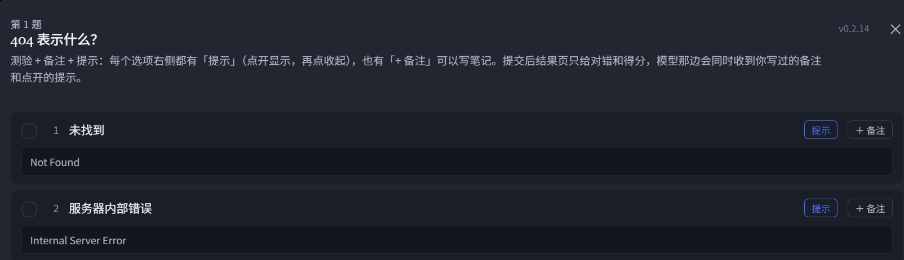

<div align="center">
  

  <h1>DSH Visual Option</h1>

  <p><strong>ASK-USER-QUESTION を、目に見えるものに変える</strong></p>

  <p>
    <a href="https://github.com/deepseek-ai/deepseek-harness">DeepSeek Harness</a>（以下 DSH）の Web GUI 向けプラグイン<br>
    ツール <code>let_user_choose</code> を登録します：モデルは HTML テキスト / Web ページのリンク / ローカルパスを渡して、プレビュー付きの選択をユーザーに提示できます
  </p>

  <p>
    <a href="#インストール">インストール</a> ·
    <a href="#クイックスタート">クイックスタート</a> ·
    <a href="#ツールパラメータ">ツールパラメータ</a> ·
    <a href="#設定">設定</a> ·
    <a href="#セキュリティと制限">セキュリティと制限</a>
  </p>

  <p>
    <a href="../README.md">汉语</a> ·
    <a href="./README-CN-Traditional.md">汉语(漢語)</a> ·
    <a href="./README-EN.md">English</a> ·
    <a href="./README-JP.md">にほんご</a> ·
    <a href="./README-ES.md">Español</a> ·
    <a href="./README-FR.md">Français</a>
  </p>
</div>

---

## ビフォーアフター

<table>
  <tr>
    <td align="center"><b>visual-option（可視化バージョン）</b></td>
    <td align="center"><b>ask-user-question（通常バージョン）</b></td>
  </tr>
  <tr>
    <td align="center"></td>
    <td align="center"></td>
  </tr>
</table>

## 着想

プレーンテキストの会話では、モデルが `ask_user_question` で「A か B か」と聞いても、ユーザーはそれが何を指すのか聞き返さなければならないことがあります

`let_user_choose` は候補を**そのまま描画**します：2 つのランディングページが iframe で並び、PHP テンプレートのソースコードが表示され、確認ボタンが 1 つ出る、ユーザーが選び、どの選択肢にもひとことメモを添えられ、モデルが受け取るのはもう 1 ラウンドの会話ではなく構造化データです

全体は 3 ステップだけです：
1. モデルが `let_user_choose` を呼び、質問と候補をプラグインに渡します
2. プラグインはマシン上に一時的なプレビューサービスを起動し、選択待ちの内容を現在のセッションのダイアログに送ります
3. ユーザーが選択・メモ記入・送信を行うと、モデルは `{ status, answers[], summary }` を受け取ります

## 特長

### 5 つのモード

1 つのリクエストに複数の質問を入れられ、UI は 1 ステップに 1 問ずつ表示します、下部の `‹ 1 / 2 ›` が進捗です、異なるモードを同じリクエストに混在させることもでき、たとえば 1 問目を複数選択、2 問目を自由入力にできます

| モード | 内容 |
| --- | --- |
| `single` | 単一選択、1 行クリックで選択 |
| `multi` | 複数選択、複数の選択肢を選べる |
| `fill` | 自由入力、テキストを直接入力 |
| `confirm` | 確認、2 つの選択肢を 1 行に並べ、1 クリックで送信 |
| `test` | クイズの切り替え（`test: true`）、選択肢を `correct: true` で正解として印付けし、送信後は正誤と得点のみ表示 |

#### 1. 単一選択 (single)
<p align="center">
  
</p>

#### 2. 複数選択 (multi)
<p align="center">
  
</p>

#### 3. 自由入力 (fill)
<p align="center">
  
</p>

#### 4. 確認 (confirm)
<p align="center">
  
</p>

#### 5. クイズ (test)
<p align="center">
  <b>出題状態：</b><br>
  
</p>
<p align="center">
  <b>回答送信：</b><br>
  
</p>

### 3 種類のプレビュー

- `url`：任意の http(s) ページをそのまま iframe で表示（外部サイトにはより厳しい sandbox を適用）
- `path`：ローカルのページ / 静的ファイル、Host が起動する使い捨てのプレビューサービスから配信し、パスの越境を防ぐ保護付き
- `inline`：インライン HTML / PHP のソース、必要に応じて PHP を実行（設定可能）

### 選択肢のメモ
各選択肢には個別にメモを書けます、メモは `answers[].notes = [{ label, note }]` として返ります

<p align="center">
  
</p>

### ヒント
選択肢には `hint` を持たせられ、UI 上では小さなボタンになり、開いたときだけ表示されます、どのヒントを開いたかは `answers[].hints` として返るので、モデルはどの回答がヒントに助けられたかを知ることができます

<p align="center">
  
</p>

### 質問を返す
どのモード・どのステップでも、ユーザーは「質問」を押してひとこと主会話に送り返せます、ダイアログはすぐに閉じ、ツールは `status: "asked"` と質問本文を返します、モデルは会話の中でそれに答え、必要なら改めて選択を出し直します

<p align="center">
  
</p>

### その他とスキップ
各選択肢の質問には「その他」の入力欄があり、既存の項目を選びたくない場合は自分の答えを直接書けます、テキストは `answers[].custom` として返り、各問はスキップもでき、その場合の回答は `skipped: true` になります（必須の質問でも同様に通ります）

<p align="center">
  
</p>

### ネイティブなダイアログ
GUI のテーマ変数、マスク、角丸、フォーカスリングを再利用し、Esc によるキャンセル、フォーカストラップ、`prefers-reduced-motion` に対応します

### 多言語対応
**6 セットの文言**（簡体字中国語、繁体字中国語、English、にほんご、Español、Français）を内蔵し、GUI の言語に追従して自動で切り替わります、プラグイン内で手動選択もできます

### 幅の自動調整
プレビュー幅は `自動 / 768 / 390` から選べ、同じ内容をデスクトップ幅とスマートフォン幅で確認できます

## インストール

DSH `0.2.0-rc` 以上、Web profile が必要です

> [!NOTE]
> 本プロジェクトは以前 `dsh-let-user-choose` という名前でした、旧バージョンからアップグレードする場合は、`package.json` の依存名と `dsh.profile.bundles` の項目を `dsh-visual-option` に合わせて変更してください、ツール名と API パスは変わりません

### Method 1. dsh プラグインマーケット

メイン画面 -> プラグイン -> プラグインを追加 -> プラグインのリンクを入力：
- GitHub Repo: `github:JinSuperOfficial/dsh-visual-option`
- NPM Publish Repo: `dsh-visual-option`

### Method 2. dsh cli

```shell
dsh plugin_manager install_bundle link:/path/to/dsh-visual-option
```
インストール後に再起動してください、hot-reload を入れている場合は、その通知を待てばOKです

### Method 3. AI にインストールさせる

```prompt-text
Help me to install this plugin: dsh-visual-option
GitHub Repo: `github:JinSuperOfficial/dsh-visual-option`
NPM: `dsh-visual-option`
Or you could look up the repo: "https://github.com/JinSuperOfficial/dsh-visual-option"
Thanks.
```

### Method 4. 手動インストール

次の 2 ステップに相当します：
1. profile の `package.json` に依存を追加し、`dsh.profile.bundles` に列挙します：

   ```json
   {
     "dependencies": { "dsh-visual-option": "link:/path/to/dsh-visual-option" },
     "dsh": { "profile": { "bundles": ["dsh-visual-option"] } }
   }
   ```
2. プラグインに同梱の `cordis.patch.yml` が、読み込み時に `visual-option` ノード（既定設定込み）を挿入します

## クイックスタート

簡単な HTML ファイルを 2 つ用意します、たとえばセッションの作業ディレクトリの `preview/` に置きます：

```html
<!-- preview/a.html -->
<!doctype html>
<html>
  <body style="margin:0;background:#f8f2e9;font-family:serif;padding:24px">
    <h1>Option A</h1>
    <p>Warm editorial</p>
  </body>
</html>
```

```html
<!-- preview/b.html -->
<!doctype html>
<html>
  <body style="margin:0;background:#0b1020;color:#fff;font-family:sans-serif;padding:24px">
    <h1>Option B</h1>
    <p>Cool dashboard</p>
  </body>
</html>
```

最小の単一選択リクエスト：

```json
{
  "title": "Pick a landing page",
  "detail": "Both options are below, click one",
  "timeoutSeconds": 600,
  "questions": [
    {
      "id": "plan",
      "question": "Which direction should we take",
      "mode": "single",
      "required": true,
      "options": [
        {
          "label": "Option A · warm editorial",
          "description": "big type with a warm gradient",
          "preview": { "kind": "path", "value": "preview/a.html" }
        },
        {
          "label": "Option B · cool dashboard",
          "description": "data cards with a cool gradient",
          "preview": { "kind": "path", "value": "preview/b.html" }
        }
      ]
    }
  ]
}
```

モデル側が受け取る戻り値：

```json
{
  "status": "answered",
  "answers": [
    {
      "id": "plan",
      "selected": ["Option B · cool dashboard"],
      "notes": [{ "label": "Option A · warm editorial", "note": "tighter layout, a bit heavy on color" }]
    }
  ],
  "summary": "plan: Option B · cool dashboard"
}
```

`status` の値：`answered` / `cancelled` / `timeout` / `asked`、タイムアウトの戻り値には `hint` が 1 つ付き、キャンセルとタイムアウトには `answers` が含まれません

## ツールパラメータ

| フィールド | 型 | 説明 |
| --- | --- | --- |
| `title` | string | ダイアログのタイトル、既定は「Choose」 |
| `detail` | string | タイトル下の一段の説明 |
| `timeoutSeconds` | integer | `30–3600`、省略時はプラグイン設定の `timeoutMs`（10 分） |
| `questions` | array | 1–8 個の質問、詳細は下記 |
| `test` | boolean | クイズの切り替え、送信後は正誤と得点のみ |

**question**

| フィールド | 型 | 説明 |
| --- | --- | --- |
| `id` | string | 回答の返送に使う一意の ID |
| `question` | string | 質問の本文 |
| `header` | string | 小見出し（任意） |
| `detail` | string | 補足説明（任意） |
| `mode` | enum | `single` / `multi` / `fill` / `confirm` |
| `required` | boolean | 必須、未入力なら下部に注意が出て送信できない |
| `placeholder` | string | `fill` 専用 |
| `options` | array | 選択肢、`fill` では空か未指定にする |

**option**

| フィールド | 型 | 説明 |
| --- | --- | --- |
| `label` | string | 選択肢名（メモのキーにもなる） |
| `description` | string | 選択肢の説明（任意） |
| `preview` | object | `{ kind: "url" \| "path" \| "inline", value, title? }` |
| `correct` | boolean | クイズモードで正解を印付ける |
| `hint` | string | 任意のヒント、「ヒント」を押したときだけ展開 |

**answers**

| フィールド | 型 | 説明 |
| --- | --- | --- |
| `id` | string | 対応する質問の id |
| `selected` | string[] | 選択された選択肢の label |
| `custom` | string | 自由入力の回答、または「その他」に手書きしたテキスト |
| `hints` | string[] | ユーザーがヒントを開いた選択肢の label |
| `skipped` | boolean | 質問全体をスキップ |
| `notes` | array | `[{ label, note }]` の選択肢メモ |

> [!IMPORTANT]
> 制限：質問 ≤ 8、選択肢 ≤ 12、`label` ≤ 200 字、メモ ≤ 1000 字、自由入力 ≤ 4000 字、未知のフィールドは拒否されます、`fill` の質問は選択肢メモを受け付けません

**モードに関するいくつかの約束**
- `confirm` の質問が 1 つだけなら、点選した時点で送信されます
- 質問が複数ある場合、`confirm` は 2 択 1 行の表示のみで、送信ボタンは別途押す必要があります
- クイズモードでは各問に少なくとも 1 つの `correct: true` が必要で、送信後は `score: { correct, total }` が返ります
- すべてのモードの回答は `answers[]` に `id` で対応付けられます

## プレビューの詳細

| kind | レンダリング方式 | 説明 |
| --- | --- | --- |
| `url` | iframe | `http(s)` のみ、外部ドメインには `allow-same-origin` を含まない sandbox を適用 |
| `path` | iframe | 相対パスはセッションの `cwd` を基準に解決し、root 内に収まる必要あり、単一ファイルまたはディレクトリを指せる |
| `inline` | iframe / ソース | インライン HTML はそのまま描画、`inline` + PHP で `phpBinary` が設定されていれば実行して出力を描画し、そうでなければソースを表示 |

**PHP の挙動**
- `phpBinary: ""`（既定）——ソースのみ表示、ラベルは「ソースプレビュー（PHP 未実行）」
- `phpBinary: "auto"`——`PATH` 上の `php` を探し、見つかれば実行
- その他の値——実行ファイルのパスとして扱う
- 実行には 8 秒のタイムアウトと 2 MiB の出力上限があり、エラーはページに表示されません

**プレビューサービス**
- リクエストごとに独立した `http.createServer` を起動し、`127.0.0.1:0`（ランダムポート）にバインドします
- インライン文書は `/<token>.html`、静的ファイルは `/` にマウントされ、token はランダムです
- 回答 / キャンセル / タイムアウトの後は遅延して閉じ、ポートは回収されます

## 待機とキャンセル

- ダイアログが開くとカウントダウンが始まります（`残り m:ss`）
- ユーザーが最初にマウスを動かす、押す、ホイールを回す、またはキー入力する → クライアントは即座にローカルでカウントダウンを隠し、`/api/let-user-choose/hold` に POST します、Host はタイマーを 1 時間の安全用フォールバックに切り替えます
- `Esc`、右上の `×`、下部の「キャンセル」はいずれも `cancelled` で終了します
- 「質問」は `asked` で終了し、質問を主会話に返します
- ブラウザのタブが背後に回るとポーリングは停止し、前面に戻ると即座に 1 回取得します
- タイムアウトは `timeout` で終了します

## 設定

プラグインノード（`cordis.patch.yml` の insert、または profile の patch 層）に書きます：

```yaml
- id: visual-option
  name: dsh-visual-option
  config:
    timeoutMs: 600000
    maxInlineBytes: 65536
    phpBinary: ""
```

## HTTP インターフェース（内部）

クライアントのダイアログと Host のやり取りは、GUI 標準の `/api` チャネルのみを使います：

| パス | メソッド | 役割 |
| --- | --- | --- |
| `/api/let-user-choose/pending?session=` | GET | 現在のセッションに未処理の選択があるか |
| `/api/let-user-choose/answer` | POST | 回答の送信 / キャンセル / 質問 |
| `/api/let-user-choose/hold` | POST | ユーザーが操作済みなので制限時間を解除 |
| `/api/let-user-choose/source` | GET | ソースプレビューの内容 |

## セキュリティと制限

- プレビューサービスはループバックアドレスのみをリッスンします：別のマシンから GUI を開いた場合、ローカルプレビューは読み込めません（ダイアログにその旨が表示されます）、外部 `url` のプレビューは引き続き利用できます
- パスプレビューは realpath 検証を行い、`..`、絶対パスによる脱出、シンボリックリンクによる脱出を拒否します
- インラインコンテンツにはサイズ上限があり、超過時は即座に拒否します
- 参照ページがアップロードされることはなく、プレビューはあなたのマシン上でのみ開きます
- ダイアログは現在見ているセッションにのみ表示されます、バックグラウンドのセッションでの呼び出しはタイムアウトまで待ち続けます

> [!WARNING]
> PHP の実行は既定で無効です、有効化（例：`phpBinary: "auto"`）は、モデルが提供したコードをこのマシン上で実行することを意味し、リモートコード実行（RCE）のリスクがあります、ご自身で評価したうえで、管理された環境で使用してください

## 開発

```bash
node selfcheck.mjs
```

セルフチェックの対象：

```
args    → options, notes, timeout bounds, unknown fields
preview → MIME, 404, directory, escapes, symlinks, inline HTML, PHP source and execution
hub     → pending / answer / hold / ask / cancel / timeout / abort / dispose
notes   → round trip, empty notes dropped, fill rejects notes
other   → custom answer without a selection, required checks
skip    → skipping required questions, conflicts rejected
hint    → hint reporting, unknown labels rejected
test    → correct markers, score returned
```

受け入れ動画のプロジェクトは `demo/` にあります（Electron のオフスクリーンレンダリング + 実際の `client.js` + フレーム録画から合成）：

```bash
cd demo
npm install
python3 -m http.server 4610 --bind 127.0.0.1 &
~/.dsh/electron/electron app      # demo/out/frames/ に録画
node encode.mjs                   # demo/out/acceptance.mp4 に合成
```

## プロジェクト構成

```
dsh-visual-option/
├── index.js            # host plugin: tool registration, /api routes, config
├── client.js           # browser dialog: steps, previews, notes, hints, ask, test
├── lib/
│   ├── args.mjs        # argument validation
│   ├── preview.mjs     # preview server (iframe / source / PHP)
│   └── hub.mjs         # pending requests, timers, hold, answer validation
├── cordis.patch.yml    # mount declaration and defaults
├── selfcheck.mjs       # self test
├── test/fixtures/      # preview fixtures
├── demo/               # acceptance video project
├── assets/             # screenshots used by this README
├── readme/             # translations
├── logo.svg
└── icon.svg
```

## Roadmap

- [ ] npm / dsh プラグインマーケットへの公開
- [ ] 画像（`png/jpg`）と PDF のプレビュー
- [ ] リモートアクセス時のプレビュートンネル（現在はローカル限定）
- [ ] より細粒度の PHP サンドボックス（タイムアウト、無効化関数、読み取り専用）
- [ ] さらなる言語への対応

## License

MIT © JinSuperOfficial

© 金旭 2026 · JinSuper™
